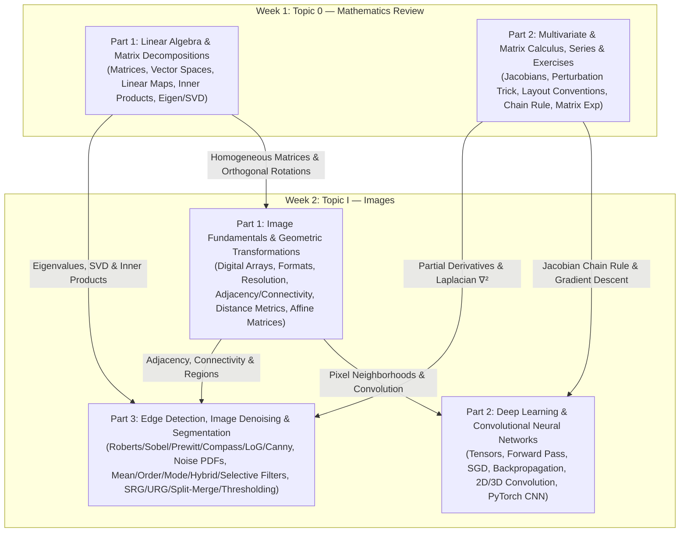

# MATH70103: Unstructured Data Analysis — Complete Study Notes Index

Welcome to your comprehensive, **zero-skip study guide** for **MATH70103: Unstructured Data Analysis (Autumn 2026–2027)**. Every single concept, definition, theorem, slide, worked example, live session annotation, and practice exercise from the course materials is explained here step by step in plain English, accompanied by visual diagrams, tables, and mathematical derivations.

---

## Course Architecture & How Everything Connects

---

## Directory of Study Notes in This Folder

| Study Note File | Source Materials Covered (100% No-Skip) | Key Topics Inside |
| :--- | :--- | :--- |
| **[Week01_Part1_Linear_Algebra_and_Decompositions.md](./Week01_Part1_Linear_Algebra_and_Decompositions.md)** | • `01-week01/01-MLDS_UDA_2026-27_MathRecap.pdf` (Secs 1–2.5) • `01-week01/02-MLDS_UDA_2026-27_MathRecap_Exercises.pdf` (Prob 1) • `01-week01/03-MLDS_UDA_2026-27_MathRecap_Solutions.pdf` (Prob 1) • `01-week01/04-MLDS_UDA_26_27_Matrices.pdf` (Slides 1–6) • `02-week02/10-UDA2026-27_Live Session 3_Images_annotated.pdf` (Linear Maps) | • Matrix addition, scalar & matrix multiplication, non-commutativity • Identity, Kronecker delta $\delta_{ij}$, Inverse & Transpose proofs • Trace $\operatorname{tr}(A)$ and scalar transpose trick • Vector spaces (8 axioms), subspaces, span, linear independence, basis, dimension • Linear maps, isomorphisms, matrix representations • Inner products, norms, metrics, orthogonal matrices, Gram matrix proofs • Eigenvalues, diagonalization ($A=PDP^{-1}$), and SVD ($A=U\Sigma V^\top$) |
| **[Week01_Part2_Matrix_Calculus_Series_and_Exercises.md](./Week01_Part2_Matrix_Calculus_Series_and_Exercises.md)** | • `01-week01/01-MLDS_UDA_2026-27_MathRecap.pdf` (Secs 3.1–3.5) • `01-week01/02-MLDS_UDA_2026-27_MathRecap_Exercises.pdf` (Probs 2–3) • `01-week01/03-MLDS_UDA_2026-27_MathRecap_Solutions.pdf` (Probs 2–3) • `01-week01/04-MLDS_UDA_26_27_Matrices.pdf` (Slides 7–16) | • Difference quotient, derivatives, Taylor & Maclaurin series • Partial derivatives, gradients ($1\times n$), Jacobians ($m\times n$) • The Perturbation Trick: $f(x+h) = f(x) + \mathrm{D}f(x)h + o(\|h\|)$ • Least squares normal equations & 1-layer neural network gradient • Matrix calculus layout conventions (block-wise vs. vectorized) • Commutativity & transpose traps in matrix derivatives • Multivariate & matrix chain rule ($\frac{\partial z}{\partial X} = \frac{\partial z}{\partial Y}A$) • Matrix power series, Matrix Exponential $e^A$, Neumann series $(I-A)^{-1}$ • Full step-by-step solutions to all Math Recap Practice Exercises |
| **[Week02_Part1_Image_Fundamentals_and_Transformations.md](./Week02_Part1_Image_Fundamentals_and_Transformations.md)** | • `02-week02/01-MLDS_UDA_2026-27_ImageNotes.pdf` (Secs 1–2.5) • `02-week02/02-MLDS_UDA_Slides_IntroImages-1.pdf` • `02-week02/10-UDA2026-27_Live Session 3_Images_annotated.pdf` | • Continuous $f(x,y)$ vs. discrete digital images $I(r,c)$ • Binary, grayscale, and RGB images; array vs. matrix product • Raster (TIFF, PSD, JPG, PNG, GIF, BMP) vs. Vector (AI, EPS, SVG, PDF) formats & file headers • Spatial resolution (line pairs/mm, DPI) vs. Intensity resolution ($k$-bit depth) • 4-, diagonal, and 8-neighbors; open vs. closed neighborhoods • 4-, 8-, and $m$-adjacency (mixed adjacency) & digital paths • Connected components, regions, boundaries vs. local edges • Distance metrics: Euclidean $d_e$, City-block $d_4$, Chessboard $d_8$, and $m$-path distance $d_m$ • Geometric transformations & $3\times 3$ homogeneous affine matrices |
| **[Week02_Part2_Deep_Learning_and_CNNs.md](./Week02_Part2_Deep_Learning_and_CNNs.md)** | • `02-week02/01-MLDS_UDA_2026-27_ImageNotes.pdf` (Secs 3.1–3.3) • `02-week02/03-MLDS_UDA_Slides_CNNImages.pdf` • `02-week02/04-MLDS_UDA_CNN.ipynb` • `02-week02/09-UDA2026-27_Live Session 2_Images-ANNOTATED.pdf` • `02-week02/10-UDA2026-27_Live Session 3_Images_annotated.pdf` | • Tensors (Orders 0, 1, 2, 3, 4) and recursive vectorization $\operatorname{vec}(A)$ • CNN layer-by-layer forward pass, Softmax, $\ell_2$ vs. Cross-Entropy loss • Gradient Descent (GD) vs. Stochastic Gradient Descent (SGD), epochs & minibatches • Error Backpropagation: parameter gradients $\frac{\partial z}{\partial \mathbf{w}^\ell}$ vs. error signals $\frac{\partial z}{\partial \mathbf{x}^\ell}$ • ReLU activation & full numerical forward/backward pass walkthrough • Input sensitivity & adversarial examples (Panda $\to$ Gibbon) • 2D & 3D Convolution, zero-interleaving extension, output size formula • Line-by-line PyTorch CNN walkthrough with exact tensor shape tracking |
| **[Week02_Part3_Edge_Detection_Denoising_and_Segmentation.md](./Week02_Part3_Edge_Detection_Denoising_and_Segmentation.md)** | • `02-week02/01-MLDS_UDA_2026-27_ImageNotes.pdf` (Secs 4–6) • `02-week02/05-MLDS_UDA_Slides_EdgeDetectionImages.pdf` • `02-week02/06-MLDS_UDA_Slides_DenoisingImages.pdf` • `02-week02/07-MLDS_UDA_Slides_SegmentationImages.pdf` | • Step, line, and junction edges; 1st vs. 2nd derivatives • Roberts, Sobel, Prewitt, Kirsch Compass, and Robinson Compass operators • Continuous & discrete Laplacian masks (4-neighbor, 8-neighbor, separable) • Marr–Hildreth Laplacian of Gaussian (LoG) derivation, $5\times 5$ & $17\times 17$ masks, $n\ge 6\sigma$ rule • Canny 4-stage optimal detector, Boie–Cox, Shen–Castan, Pratt's Figure of Merit ($\text{FOM}_P$) • Additive/multiplicative noise, SNR, Gaussian/Impulse/Uniform/Rayleigh/Speckle PDFs • Arithmetic, Geometric, Harmonic, Contraharmonic, & Nonlinear Mean filters • Median, Min, Max, Mid-point, Mode (truncated-median), Hybrid, & Selective filters • Formal 5 axioms of Segmentation; Seeded (SRG) & Unseeded (URG) Region Growing • Quadtree Region Splitting & Merging; Global, Iterative, Multi-level & Adaptive Thresholding |

---

## Homework 1 Question-to-Concept Cross-Reference Table

Every single sub-question in **[00-homework01/HW1_Study_Guide.md](../00-homework01/HW1_Study_Guide.md)** is directly linked to its corresponding concept and concrete worked example in the `Study_Notes/` files below:

| HW1 Question | Marks | Core Mathematical / Coding Concept | Exact Section in `Study_Notes/` | Original Lecture Material |
| :--- | :---: | :--- | :--- | :--- |
| **Prob 1.1(a)** | 3 | Matrix multiplication & trigonometric angle-sum closure of $E(2)$ | • [Week01 Part 1 §1.2](./Week01_Part1_Linear_Algebra_and_Decompositions.md) • [Week02 Part 1 §5.1](./Week02_Part1_Image_Fundamentals_and_Transformations.md) | `ImageNotes` Sec 2.5 (pp. 11–12) `MathRecap` Sec 2.1 (p. 2) |
| **Prob 1.1(b)** | 3 | Matrix inverse $A^{-1}$, orthogonal rotation $R_\theta^{-1} = R_\theta^\top = R_{-\theta}$ | • [Week01 Part 1 §1.3 & §4.2](./Week01_Part1_Linear_Algebra_and_Decompositions.md) • [Week02 Part 1 §5.2](./Week02_Part1_Image_Fundamentals_and_Transformations.md) | `ImageNotes` Sec 2.5 (p. 12) `MathRecap` Sec 2.1 & 2.4 (pp. 3, 9) |
| **Prob 1.1(c)** | 4 | Euclidean distance metric $d_e(p,q) = \|p-q\|_2$ & orthogonal isometry | • [Week01 Part 1 §4.1–4.2](./Week01_Part1_Linear_Algebra_and_Decompositions.md) • [Week02 Part 1 §4.3](./Week02_Part1_Image_Fundamentals_and_Transformations.md) | `ImageNotes` Sec 2.4.3 (Def 2.8, p. 10) `MathRecap` Sec 2.4 (Defs 2.32–2.35) |
| **Prob 1.2** | 10 | Chaining $3\times 3$ affine matrices ($A = T \cdot R \cdot S$) & inverse image warping | • [Week02 Part 1 §5.1–5.2](./Week02_Part1_Image_Fundamentals_and_Transformations.md) | `ImageNotes` Sec 2.5 (Table 1, p. 12) `IntroImages` Slides 13–19 |
| **Prob 2.1** | 5 | Computational graph forward pass, partial derivatives, Jacobian & Chain Rule (Backprop) | • [Week01 Part 2 §1.2 & §3](./Week01_Part2_Matrix_Calculus_Series_and_Exercises.md) • [Week02 Part 2 §2.3 & §3.2](./Week02_Part2_Deep_Learning_and_CNNs.md) | `ImageNotes` Sec 3.1 & 3.2.4 (pp. 14, 17) `Live Session 2` Slides 6–9 |
| **Prob 2.2** | 5 | 2D discrete convolution sliding window & output matrix dimension $(M-m+1)\times(N-n+1)$ | • [Week02 Part 2 §4.1 & §4.3](./Week02_Part2_Deep_Learning_and_CNNs.md) | `ImageNotes` Sec 3.2.5 (Ex 3.4, p. 18) `CNNImages` Slides 14–18 |
| **Prob 2.3** | 10 | PyTorch CNN architecture (`Conv2d`, `BatchNorm2d`, `ReLU`, `MaxPool2d`, `Linear`), Cross-Entropy & SGD/Adam | • [Week02 Part 2 §3.1–3.2 & §5](./Week02_Part2_Deep_Learning_and_CNNs.md) | `ImageNotes` Sec 3.3 (pp. 19–22) `04-MLDS_UDA_CNN.ipynb` `Live Session 3` Slide 3 |
| **Prob 3.1** | 10 | Product rule, chain rule, 2nd partial derivatives ($\nabla^2 = \frac{\partial^2}{\partial x^2}+\frac{\partial^2}{\partial y^2}$) & Laplacian of Gaussian (LoG) | • [Week01 Part 2 §1.1–1.2](./Week01_Part2_Matrix_Calculus_Series_and_Exercises.md) • [Week02 Part 3 Part A §3.2](./Week02_Part3_Edge_Detection_Denoising_and_Segmentation.md) | `ImageNotes` Sec 4.3 (Eqs 12–14, pp. 26–28) `EdgeDetection` Slides 22–25 |
| **Prob 3.2** | 4 | Discrete first-order gradient masks, Prewitt vertical operator $S_y(r,c)$ & zero-padding borders | • [Week02 Part 3 Part A §2.2](./Week02_Part3_Edge_Detection_Denoising_and_Segmentation.md) | `ImageNotes` Sec 4.2 (Def 4.3, p. 25) `EdgeDetection` Slides 12–14 |
| **Prob 3.3** | 6 | Comparing Roberts, Prewitt, Sobel, Compass, Laplacian/LoG, and Canny edge detectors in Python | • [Week02 Part 3 Part A §2–4](./Week02_Part3_Edge_Detection_Denoising_and_Segmentation.md) | `ImageNotes` Sec 4.2–4.6 (pp. 23–34) `EdgeDetection` Slides 8–26 |
| **Prob 4.1** | 6 | Noise PDFs (Gaussian, Uniform, Salt & Pepper / Impulse, Rayleigh) & random variable transformation | • [Week02 Part 3 Part B §1](./Week02_Part3_Edge_Detection_Denoising_and_Segmentation.md) | `ImageNotes` Sec 5.1 (pp. 35–38) `Denoising` Slides 3–8 |
| **Prob 4.2** | 9 | Spatial denoising filters: Mean (Arithmetic, Geometric, Harmonic, Inverse Harmonic), Median & Mode (Truncated-Median) | • [Week02 Part 3 Part B §2–3](./Week02_Part3_Edge_Detection_Denoising_and_Segmentation.md) | `ImageNotes` Sec 5.2.1 (pp. 39–42) `Denoising` Slides 10–12 |
| **Prob 4.3** | 5 | Denoising `skimage.data.coins()` corrupted with Gaussian noise ($\sigma = 0.155$) | • [Week02 Part 3 Part B §2](./Week02_Part3_Edge_Detection_Denoising_and_Segmentation.md) | `ImageNotes` Sec 5.3 (pp. 44–46) |
| **Prob 5.1** | 10 | Region-based segmentation: Seeded Region Growing (SRG), Unseeded Region Growing (URG) & Quadtree Split/Merge | • [Week02 Part 1 §4.2](./Week02_Part1_Image_Fundamentals_and_Transformations.md) • [Week02 Part 3 Part C §1–3](./Week02_Part3_Edge_Detection_Denoising_and_Segmentation.md) | `ImageNotes` Sec 6.1 (pp. 47–49) `Segmentation` Slides 9–13 |
| **Prob 5.2** | 10 | Edge-based segmentation (Edge detection + morphological closing/hole-filling or gradient watershed) | • [Week02 Part 1 §4.2](./Week02_Part1_Image_Fundamentals_and_Transformations.md) • [Week02 Part 3 Part A & Part C](./Week02_Part3_Edge_Detection_Denoising_and_Segmentation.md) | `ImageNotes` Sec 2.4.2 (p. 9) & Sec 6 (p. 47) |

