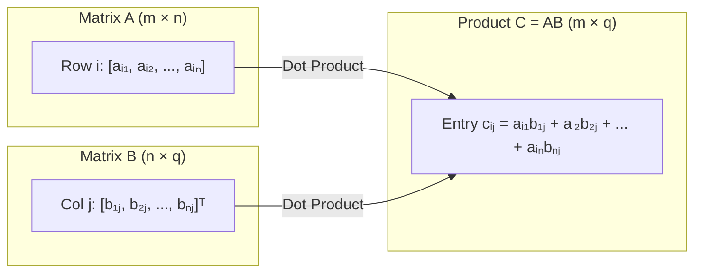

# Week 1 (Part 1): Linear Algebra, Inner Product Spaces & Matrix Decompositions

**Sources Covered (100% No-Skip)**:
- `01-week01/01-MLDS_UDA_2026-27_MathRecap.pdf` (Sections 1 & 2.1–2.5, pp. 1–11)
- `01-week01/04-MLDS_UDA_26_27_Matrices.pdf` (Slides 1–6)
- `01-week01/02-MLDS_UDA_2026-27_MathRecap_Exercises.pdf` & `03-Solutions.pdf` (Problem 1)
- `02-week02/10-UDA2026-27_Live Session 3_Images_annotated.pdf` (Linear Transformations Slides 4–14)

---

## 1. Matrices and Matrix Algebra (Section 2.1)

### 1.1 What is a Matrix? (Definition 2.1)
An **$m \times n$ matrix** is a rectangular 2D array of real numbers arranged into **$m$ horizontal rows** and **$n$ vertical columns**:
$$\text{Shape} = (\text{Rows} \times \text{Columns}) = m \times n$$
- **Row vector in $\mathbb{R}^n$**: A $1 \times n$ matrix, e.g., $\begin{pmatrix} x_1 & x_2 & \dots & x_n \end{pmatrix}$.
- **Column vector in $\mathbb{R}^m$**: An $m \times 1$ matrix, e.g., $\begin{pmatrix} y_1 \\ \vdots \\ y_m \end{pmatrix}$.
- **Examples from Notes (p. 2)**:
  $$\underbrace{\begin{pmatrix} 1 & 2 & -3 \\ \sqrt{2} & \pi & 0 \end{pmatrix}}_{2 \times 3 \text{ matrix}}, \qquad \underbrace{\begin{pmatrix} 1 \\ -1.2 \\ -1 \end{pmatrix}}_{3 \times 1 \text{ matrix (column vector)}}, \qquad \underbrace{\begin{pmatrix} 0 & 0 \\ 0 & 0 \end{pmatrix}}_{2 \times 2 \text{ zero matrix}}$$

---

### 1.2 The Three Fundamental Matrix Operations

#### 1. Matrix Addition (Definition 2.2)
- **Rule**: Two matrices $A = (a_{ij})_{m \times n}$ and $B = (b_{ij})_{p \times q}$ can be added **if and only if they have the exact same dimensions** ($m = p$ and $n = q$).
- **Formula**: Entry-by-entry addition:
  $$c_{ij} = a_{ij} + b_{ij} \quad \text{for } 1 \le i \le m, \; 1 \le j \le n$$
- **Concrete Example (Slide 5)**:
  $$\begin{pmatrix} 1 & 2 & -3 \\ \sqrt{2} & \pi & 0 \end{pmatrix} + \begin{pmatrix} -1 & 3 & \pi \\ 0 & 0 & -4 \end{pmatrix} = \begin{pmatrix} 1+(-1) & 2+3 & -3+\pi \\ \sqrt{2}+0 & \pi+0 & 0+(-4) \end{pmatrix} = \begin{pmatrix} 0 & 5 & \pi-3 \\ \sqrt{2} & \pi & -4 \end{pmatrix}$$

#### 2. Scalar Multiplication (Definition 2.3)
- **Rule**: Any matrix $A = (a_{ij})_{m \times n}$ can be multiplied by any scalar $k \in \mathbb{R}$ by multiplying **every entry** by $k$:
  $$(kA)_{ij} = k a_{ij}$$
- **Concrete Example (Slide 7)**:
  $$5 \begin{pmatrix} 1 \\ -2 \\ -1 \end{pmatrix} = \begin{pmatrix} 5 \\ -10 \\ -5 \end{pmatrix}$$

#### 3. Matrix Multiplication (Definition 2.4)
- **Compatibility Rule**: We can multiply $A$ ($m \times n$) by $B$ ($p \times q$) to form $C = AB$ **if and only if the inner dimensions match** ($n = p$, i.e., number of columns of $A$ = number of rows of $B$).
- **Output Shape**:
  $$\underset{(m \times \mathbf{n})}{A} \cdot \underset{(\mathbf{n} \times q)}{B} = \underset{(m \times q)}{C}$$
- **Formula**: To get entry $c_{ij}$ (row $i$, column $j$ of $C$), take the **dot product of row $i$ of $A$ ($\mathbf{r}_i$) with column $j$ of $B$ ($\mathbf{c}_j$)**:
  $$c_{ij} = \mathbf{r}_i \cdot \mathbf{c}_j = \sum_{k=1}^n a_{ik} b_{kj}$$

- **Concrete Step-by-Step Worked Example (Kamillo Ferry Slides 9–14)**:
  Let $A = \begin{pmatrix} 1 & 2 & -3 \\ 0 & 1 & 4 \end{pmatrix}_{2\times 3}$ and $B = \begin{pmatrix} 2 & 1 \\ -1 & 0 \\ 1 & 3 \end{pmatrix}_{3\times 2}$.
  - **In $AB$**: Inner sizes are $3 = 3$, so $C = AB$ has size $2 \times 2$:
    - $c_{11} = (\text{Row 1 of } A) \cdot (\text{Col 1 of } B) = 1(2) + 2(-1) + (-3)(1) = 2 - 2 - 3 = -3$
    - $c_{12} = (\text{Row 1 of } A) \cdot (\text{Col 2 of } B) = 1(1) + 2(0) + (-3)(3) = 1 + 0 - 9 = -8$
    - $c_{21} = (\text{Row 2 of } A) \cdot (\text{Col 1 of } B) = 0(2) + 1(-1) + 4(1) = 0 - 1 + 4 = 3$
    - $c_{22} = (\text{Row 2 of } A) \cdot (\text{Col 2 of } B) = 0(1) + 1(0) + 4(3) = 0 + 0 + 12 = 12$
    $$AB = \begin{pmatrix} -3 & -8 \\ 3 & 12 \end{pmatrix}_{2\times 2}$$
  - **What if we multiply in the reverse order $BA$?** $(3 \times 2)(2 \times 3) = 3 \times 3$:
    $$BA = \begin{pmatrix} 2 & 1 \\ -1 & 0 \\ 1 & 3 \end{pmatrix}\begin{pmatrix} 1 & 2 & -3 \\ 0 & 1 & 4 \end{pmatrix} = \begin{pmatrix} 2(1)+1(0) & 2(2)+1(1) & 2(-3)+1(4) \\ -1(1)+0(0) & -1(2)+0(1) & -1(-3)+0(4) \\ 1(1)+3(0) & 1(2)+3(1) & 1(-3)+3(4) \end{pmatrix} = \begin{pmatrix} 2 & 5 & -2 \\ -1 & -2 & 3 \\ 1 & 5 & 9 \end{pmatrix}_{3\times 3}$$
    Not only is $AB \neq BA$, they don't even have the same dimensions!

- **Worked Solution to Example 2.5 (Notes p. 3)**:
  Given:
  $$A = \underbrace{\begin{pmatrix} 1 & 2 \\ -1 & 0 \end{pmatrix}}_{2\times 2}, \qquad B = \underbrace{\begin{pmatrix} 1 & 2 & 3 \\ 3 & 2 & 1 \end{pmatrix}}_{2\times 3}, \qquad C = \underbrace{\begin{pmatrix} 1 & -1 \\ 1 & -1 \end{pmatrix}}_{2\times 2}$$
  - **Addition**: Only $2\times 2$ with $2\times 2$: $A + C = \begin{pmatrix} 2 & 1 \\ 0 & -1 \end{pmatrix}$. ($A + B$ and $B + C$ are **undefined**).
  - **Matrix Multiplication**:
    - $AB = \begin{pmatrix} 1 & 2 \\ -1 & 0 \end{pmatrix}\begin{pmatrix} 1 & 2 & 3 \\ 3 & 2 & 1 \end{pmatrix} = \begin{pmatrix} 1+6 & 2+4 & 3+2 \\ -1+0 & -2+0 & -3+0 \end{pmatrix} = \begin{pmatrix} 7 & 6 & 5 \\ -1 & -2 & -3 \end{pmatrix}_{2\times 3}$.
    - $AC = \begin{pmatrix} 1 & 2 \\ -1 & 0 \end{pmatrix}\begin{pmatrix} 1 & -1 \\ 1 & -1 \end{pmatrix} = \begin{pmatrix} 3 & -3 \\ -1 & 1 \end{pmatrix}_{2\times 2}$, whereas $CA = \begin{pmatrix} 1 & -1 \\ 1 & -1 \end{pmatrix}\begin{pmatrix} 1 & 2 \\ -1 & 0 \end{pmatrix} = \begin{pmatrix} 2 & 2 \\ 2 & 2 \end{pmatrix}_{2\times 2}$ ($AC \neq CA$!).
    - $CB = \begin{pmatrix} 1 & -1 \\ 1 & -1 \end{pmatrix}\begin{pmatrix} 1 & 2 & 3 \\ 3 & 2 & 1 \end{pmatrix} = \begin{pmatrix} -2 & 0 & 2 \\ -2 & 0 & 2 \end{pmatrix}_{2\times 3}$.
    - $BA$ and $BC$ are **undefined** because $(2\times 3)$ cannot multiply $(2\times 2)$.

---

### 1.3 Identity Matrix, Inverse, Transpose & Trace

#### Identity Matrix & Kronecker Delta (Definition 2.6)
The $n \times n$ **identity matrix** $I_n$ has $1$s on the main diagonal and $0$s everywhere else. Its $(i, j)$th entry is the **Kronecker delta** $\delta_{ij}$:
$$\delta_{ij} = \begin{cases} 1 & \text{if } i = j \\ 0 & \text{if } i \neq j \end{cases}, \qquad I_2 = \begin{pmatrix} 1 & 0 \\ 0 & 1 \end{pmatrix}, \qquad I_3 = \begin{pmatrix} 1 & 0 & 0 \\ 0 & 1 & 0 \\ 0 & 0 & 1 \end{pmatrix}$$
- **Concrete Example of the Kronecker Delta Sifting Property**:
  Suppose $A = \begin{pmatrix} 5 & 8 \\ 2 & 9 \end{pmatrix}$ and we evaluate $\sum_{k=1}^2 A_{1k} \delta_{k2}$.
  Writing out the two terms ($k=1$ and $k=2$):
  $$A_{11}\delta_{12} + A_{12}\delta_{22} = 5(0) + 8(1) = 8 = A_{12}$$
  Because $\delta_{k2}$ is $0$ whenever $k \neq 2$, the sum simply replaces $k$ with $2$!

#### Matrix Inverse (Definition 2.7 & Example 2.8 Proofs + Concrete Example)
A square matrix $A \in \mathbb{R}^{n\times n}$ is **invertible** (or **non-singular**) if there exists a square matrix $B \in \mathbb{R}^{n\times n}$ such that $BA = AB = I_n$.
- **Quick Formula for a $2 \times 2$ Inverse**:
  For $A = \begin{pmatrix} a & b \\ c & d \end{pmatrix}$, if $\det(A) = ad - bc \neq 0$, swap the diagonal entries, negate the off-diagonal entries, and divide by $\det(A)$:
  $$A^{-1} = \frac{1}{ad - bc}\begin{pmatrix} d & -b \\ -c & a \end{pmatrix}$$
- **Concrete Numerical Example of $(AB)^{-1} = B^{-1}A^{-1}$**:
  Let $A = \begin{pmatrix} 1 & 2 \\ 0 & 1 \end{pmatrix}$ and $B = \begin{pmatrix} 1 & 0 \\ 3 & 1 \end{pmatrix}$.
  - Their inverses are $A^{-1} = \begin{pmatrix} 1 & -2 \\ 0 & 1 \end{pmatrix}$ and $B^{-1} = \begin{pmatrix} 1 & 0 \\ -3 & 1 \end{pmatrix}$.
  - The product is $AB = \begin{pmatrix} 1 & 2 \\ 0 & 1 \end{pmatrix}\begin{pmatrix} 1 & 0 \\ 3 & 1 \end{pmatrix} = \begin{pmatrix} 7 & 2 \\ 3 & 1 \end{pmatrix}$.
  - Using the $2\times 2$ inverse formula on $AB$ ($\det(AB) = 7(1) - 2(3) = 1$):
    $$(AB)^{-1} = \begin{pmatrix} 1 & -2 \\ -3 & 7 \end{pmatrix}$$
  - Now compare $B^{-1}A^{-1}$ vs. $A^{-1}B^{-1}$:
    $$B^{-1}A^{-1} = \begin{pmatrix} 1 & 0 \\ -3 & 1 \end{pmatrix}\begin{pmatrix} 1 & -2 \\ 0 & 1 \end{pmatrix} = \begin{pmatrix} 1 & -2 \\ -3 & 7 \end{pmatrix} \text{ (Matches!)}, \quad \text{whereas } A^{-1}B^{-1} = \begin{pmatrix} 1 & -2 \\ 0 & 1 \end{pmatrix}\begin{pmatrix} 1 & 0 \\ -3 & 1 \end{pmatrix} = \begin{pmatrix} 7 & -2 \\ -3 & 1 \end{pmatrix} \text{ (Wrong!)}$$

**Step-by-Step Proofs of Example 2.8 (Notes p. 3)**:
- **(i) Uniqueness of the Inverse**:
  Suppose both $B$ and $C$ are inverses of $A$ ($BA = AB = I$ and $CA = AC = I$). Then:
  $$B = B I = B(AC) = (BA)C = I C = C$$
- **(ii) Product Rule: $(AB)^{-1} = B^{-1}A^{-1}$**:
  $$(AB)(B^{-1}A^{-1}) = A(BB^{-1})A^{-1} = A I A^{-1} = AA^{-1} = I, \qquad (B^{-1}A^{-1})(AB) = B^{-1}(A^{-1}A)B = B^{-1}B = I$$
- **(iii) Involution Rule: $(A^{-1})^{-1} = A$**:
  Since $A A^{-1} = A^{-1} A = I$, $A$ is the inverse of $A^{-1}$.

#### Matrix Transpose (Definition 2.9 & Example 2.10 Proofs + Concrete Example)
Given an $m \times n$ matrix $A$, its **transpose** $A^\top$ is the $n \times m$ matrix obtained by swapping rows and columns: $(A^\top)_{ij} = A_{ji}$.
- **Concrete Example**:
  $$A = \begin{pmatrix} 1 & 2 & -3 \\ 0 & 1 & 4 \end{pmatrix}_{2\times 3} \implies A^\top = \begin{pmatrix} 1 & 0 \\ 2 & 1 \\ -3 & 4 \end{pmatrix}_{3\times 2}$$
  Notice Row 1 of $A$ (`1, 2, -3`) becomes Column 1 of $A^\top$!

**Step-by-Step Proofs of Example 2.10 (Notes p. 4)**:
- **(i) Linearity**: $((A+B)^\top)_{ij} = A_{ji} + B_{ji} = (A^\top)_{ij} + (B^\top)_{ij}$, and $((\lambda A)^\top)_{ij} = \lambda A_{ji} = \lambda (A^\top)_{ij}$.
- **(ii) Product Rule: $(AB)^\top = B^\top A^\top$**:
  $$\big((AB)^\top\big)_{ij} = (AB)_{ji} = \sum_{k=1}^n A_{jk} B_{ki} = \sum_{k=1}^n (B^\top)_{ik} (A^\top)_{kj} = (B^\top A^\top)_{ij}$$
- **(iii) Involution Rule**: $((A^\top)^\top)_{ij} = (A^\top)_{ji} = A_{ij} \implies (A^\top)^\top = A$.
- **(iv) Inverse Rule: $(A^\top)^{-1} = (A^{-1})^\top$**:
  Taking the transpose of $A A^{-1} = I$ gives $(A^{-1})^\top A^\top = I^\top = I$, so $(A^\top)^{-1} = (A^{-1})^\top$.

#### Trace & The Scalar Transpose Trick (Kamillo Ferry Slides 15–20)
- **Trace $\operatorname{tr}(A) = \sum_{i=1}^n a_{ii}$ (sum of diagonal entries)**:
  - **Concrete Check of $\operatorname{tr}(AB) = \operatorname{tr}(BA)$**: Using $A_{2\times 3}$ and $B_{3\times 2}$ from Section 1.2 above, we found:
    $$AB = \begin{pmatrix} \mathbf{-3} & -8 \\ 3 & \mathbf{12} \end{pmatrix}_{2\times 2} \implies \operatorname{tr}(AB) = -3 + 12 = \mathbf{9}$$
    $$BA = \begin{pmatrix} \mathbf{2} & 5 & -2 \\ -1 & \mathbf{-2} & 3 \\ 1 & 5 & \mathbf{9} \end{pmatrix}_{3\times 3} \implies \operatorname{tr}(BA) = 2 + (-2) + 9 = \mathbf{9}$$
    Even though $AB$ is $2\times 2$ and $BA$ is $3\times 3$, their traces are both $9$!
- **A Scalar is its Own Transpose ($x^\top A y = y^\top A^\top x$)**:
  - **Concrete Example**: Let $x = \begin{pmatrix} 1 \\ 2 \end{pmatrix}$, $A = \begin{pmatrix} 3 & 4 \\ 0 & 5 \end{pmatrix}$, $y = \begin{pmatrix} 1 \\ -1 \end{pmatrix}$.
    $$x^\top A y = \begin{pmatrix} 1 & 2 \end{pmatrix}\begin{pmatrix} 3 & 4 \\ 0 & 5 \end{pmatrix}\begin{pmatrix} 1 \\ -1 \end{pmatrix} = \begin{pmatrix} 3 & 14 \end{pmatrix}\begin{pmatrix} 1 \\ -1 \end{pmatrix} = 3 - 14 = \mathbf{-11}$$
    $$y^\top A^\top x = \begin{pmatrix} 1 & -1 \end{pmatrix}\begin{pmatrix} 3 & 0 \\ 4 & 5 \end{pmatrix}\begin{pmatrix} 1 \\ 2 \end{pmatrix} = \begin{pmatrix} -1 & -5 \end{pmatrix}\begin{pmatrix} 1 \\ 2 \end{pmatrix} = -1 - 10 = \mathbf{-11}$$

---

## 2. Vector Spaces, Subspaces, Span, Independence & Basis (Section 2.2)

### 2.1 Vector Spaces (Definition 2.11 & Examples 2.12–2.14)
A **real vector space** $(V, +, \cdot)$ is a set of objects ("vectors") that can be added together ($u + v \in V$) and scaled by real numbers ($\lambda v \in V$) obeying **8 sensible arithmetic rules (axioms)**:

| Axiom Group | Axiom Name | Mathematical Rule ($\forall u, v, w \in V, \; \forall \lambda, \mu \in \mathbb{R}$) |
| :--- | :--- | :--- |
| **Vector Addition** | (i) Commutativity | $u + v = v + u$ |
| | (ii) Associativity | $u + (v + w) = (u + v) + w$ |
| | (iii) Zero Vector ($0_V$) | $\exists\, 0_V \in V$ such that $v + 0_V = v = 0_V + v$ |
| | (iv) Additive Inverse ($-v$) | $\forall v \in V, \, \exists\, w \in V$ (written $-v$) such that $v + w = 0_V$ |
| **Scalar Multiplication** | (v) Distributivity over vectors | $\lambda(u + v) = \lambda u + \lambda v$ |
| | (vi) Distributivity over scalars | $(\lambda + \mu)v = \lambda v + \mu v$ |
| | (vii) Compatibility | $(\lambda \mu)v = \lambda(\mu v)$ |
| | (viii) Scalar Identity | $1v = v$ |

- **Concrete Example of a Function Space (Example 2.13)**: In $V = \mathbb{R}^{\mathbb{R}} = \{f : \mathbb{R} \to \mathbb{R}\}$, let $f(r) = r^2$ and $g(r) = 3r$. Then $(2f + g)$ is the function whose value at $r = 5$ is $2(5^2) + 3(5) = 65$.

**Step-by-Step Proofs of Example 2.14 (Notes p. 5)**:
- **(i) $\lambda 0_V = 0_V$**: $\lambda 0_V = \lambda(0_V + 0_V) = \lambda 0_V + \lambda 0_V \implies \lambda 0_V = 0_V$.
- **(ii) $0v = 0_V$**: $0v = (0 + 0)v = 0v + 0v \implies 0v = 0_V$.
- **(iii) $(-\lambda)v = -(\lambda v) = \lambda(-v)$**: $\lambda v + (-\lambda)v = (\lambda - \lambda)v = 0v = 0_V$, and $\lambda v + \lambda(-v) = \lambda(v - v) = \lambda 0_V = 0_V$.
- **(iv) If $\lambda v = 0_V$, then $\lambda = 0$ or $v = 0_V$**: If $\lambda \neq 0$, multiply by $\lambda^{-1}$: $v = (\lambda^{-1}\lambda)v = \lambda^{-1}(\lambda v) = \lambda^{-1}0_V = 0_V$.
- **(v) $-v = (-1)v$**: Set $\lambda = 1$ in (iii).

---

### 2.2 Subspaces, Linear Span, Independence, Basis & Dimension (Definitions 2.15–2.21)

#### 1. Subspaces (Definition 2.15) — Concrete Examples vs. Counterexamples in $\mathbb{R}^2$
To check if $U \subseteq V$ is a subspace, test: **(i) Is $\mathbf{0} \in U$?** **(ii) Is $u_1 + u_2 \in U$?** **(iii) Is $\lambda u \in U$?**
- **Example A (Subspace)**: $U_1 = \{(x, y) \in \mathbb{R}^2 : y = 2x\}$ (a line through the origin).
  - **(i)** $(0, 0)$ satisfies $0 = 2(0) \implies (0,0) \in U_1$.
  - **(ii)** Take $u_1 = (x_1, 2x_1)$ and $u_2 = (x_2, 2x_2)$ (e.g., $(1, 2)$ and $(3, 6)$). Their sum is $(x_1+x_2, 2(x_1+x_2))$ (e.g., $(4, 8)$, which satisfies $8 = 2(4)$) $\implies u_1 + u_2 \in U_1$.
  - **(iii)** $\lambda(x_1, 2x_1) = (\lambda x_1, 2(\lambda x_1)) \in U_1$. **Result: $U_1$ IS a subspace!**
- **Example B (NOT a Subspace — Shifted Line)**: $U_2 = \{(x, y) \in \mathbb{R}^2 : y = 2x + 1\}$.
  - **(i) Fails immediately!** Plugging in $(0, 0)$ gives $0 = 2(0) + 1 = 1$ (False!). Any line or plane that misses the origin is **never** a subspace.
- **Example C (NOT a Subspace — Parabola)**: $U_3 = \{(x, y) \in \mathbb{R}^2 : y = x^2\}$.
  - Contains $(0, 0)$, and contains $u_1 = (1, 1)$ and $u_2 = (2, 4)$.
  - **(ii) Fails closure under addition!** $u_1 + u_2 = (1+2, 1+4) = (3, 5)$, which does **not** satisfy $y = x^2$ since $5 \neq 3^2 = 9$!

#### 2. Linear Span & Linear Independence (Definitions 2.16–2.18)
- **Worked Example 2.17 (Plane Spanned by 2 Vectors in $\mathbb{R}^3$, Notes p. 6)**:
  What plane is spanned by $u_1 = (1, 1, 2)$ and $u_2 = (2, -1, 3)$?
  Any point $(x, y, z)$ in $\langle u_1, u_2 \rangle$ is a linear combination $(x, y, z) = \alpha(1, 1, 2) + \beta(2, -1, 3)$:
  $$\begin{cases} x = \alpha + 2\beta \\ y = \alpha - \beta \\ z = 2\alpha + 3\beta \end{cases} \implies \beta = \frac{x-y}{3}, \quad \alpha = \frac{x+2y}{3} \implies z = 2\left(\frac{x+2y}{3}\right) + 3\left(\frac{x-y}{3}\right) \implies \mathbf{5x + y - 3z = 0}$$
  *Concrete check*: Does $u_1 = (1, 1, 2)$ lie on $5x + y - 3z = 0$? $5(1) + 1 - 3(2) = 0$ ✓. Does $u_2 = (2, -1, 3)$? $5(2) + (-1) - 3(3) = 0$ ✓.
- **Concrete Example of Linear Independence vs. Linear Dependence**:
  - **Independent (Example 2.19)**: $v_1 = (1, 1, 2), v_2 = (2, -1, 3)$. Setting $\alpha v_1 + \beta v_2 = (0, 0, 0)$ gives $\alpha + 2\beta = 0$ and $\alpha - \beta = 0 \implies \alpha = \beta = 0$ only.
  - **Dependent**: Add a third vector $v_3 = (4, 1, 7)$ to $\{v_1, v_2\}$. Notice that $2v_1 + 1v_2 - 1v_3 = 2(1,1,2) + (2,-1,3) - (4,1,7) = (0,0,0)$ has a **non-zero** solution $(\alpha_1, \alpha_2, \alpha_3) = (2, 1, -1)$! Thus $\{v_1, v_2, v_3\}$ is **linearly dependent** because $v_3 = 2v_1 + v_2$ is redundant.

#### 3. Basis & Dimension (Definitions 2.20–2.21)
- **Concrete Example in $\mathbb{R}^2$**:
  - The standard basis is $\mathcal{E} = \{(1, 0), (0, 1)\}$ (2 vectors $\implies \dim(\mathbb{R}^2) = 2$).
  - Another valid basis is $\mathcal{B} = \{(1, 1), (1, -1)\}$: they are linearly independent, and any vector $(x, y) \in \mathbb{R}^2$ (say $(5, 1)$) can be uniquely written as $3(1, 1) + 2(1, -1) = (5, 1)$.

---

## 3. Linear Transformations & Matrix Representations (Section 2.3 & Live Session 3)

### 3.1 Definition & Matrix Construction Recipe (Definitions 2.22–2.25)
A map $T : V \to W$ is **linear** if $T(\alpha u + \beta v) = \alpha T(u) + \beta T(v)$.
- **Concrete Recipe to Find the Matrix $A$ of Any Linear Map $T : \mathbb{R}^n \to \mathbb{R}^m$**:
  Plug each standard basis vector into $T$ and write the outputs as the **columns** of $A$:
  $$A = \Big[\, T(\mathbf{e}_1) \;\Big|\; T(\mathbf{e}_2) \;\Big|\; \dots \;\Big|\; T(\mathbf{e}_n) \,\Big]$$
- **Worked Example 2.26 (Notes p. 7)**: $T(x, y, z) = (0, x, y)$.
  - Col 1: $T(1, 0, 0) = (0, 1, 0)^\top$
  - Col 2: $T(0, 1, 0) = (0, 0, 1)^\top$
  - Col 3: $T(0, 0, 1) = (0, 0, 0)^\top$
  $$A = \begin{pmatrix} 0 & 0 & 0 \\ 1 & 0 & 0 \\ 0 & 1 & 0 \end{pmatrix} \implies \text{Check on } \begin{pmatrix} 5 \\ 7 \\ 9 \end{pmatrix}: \quad \begin{pmatrix} 0 & 0 & 0 \\ 1 & 0 & 0 \\ 0 & 1 & 0 \end{pmatrix}\begin{pmatrix} 5 \\ 7 \\ 9 \end{pmatrix} = \begin{pmatrix} 0 \\ 5 \\ 7 \end{pmatrix} = T(5, 7, 9) \text{ ✓}$$

### 3.2 Live Session 3 Worked Examples with Concrete Vectors (Slides 6–13)
Let's test each transformation from Live Session 3 on concrete vectors $u = (2, 0)$ and $v = (0, 4)$:

| Transformation $T(v)$ on $\mathbb{R}^2$ | Concrete Test with $u = (2, 0), v = (0, 4)$ ($u+v = (2, 4)$) | Linear? | Matrix $A$ |
| :--- | :--- | :---: | :---: |
| **1. Identity**: $T(v) = (v_1, v_2)$ | $T(2, 4) = (2, 4) = (2, 0) + (0, 4) = T(u) + T(v)$ | **Yes** | $\begin{pmatrix} 1 & 0 \\ 0 & 1 \end{pmatrix}$ |
| **2. Constant Bias**: $T(v) = (7, v_2)$ | $T(2, 4) = (7, 4)$, but $T(u) + T(v) = (7, 0) + (7, 4) = (\mathbf{14}, 4) \neq (7, 4)$! | **No** | None |
| **3. Scaled Swap**: $T(v) = (3v_2, v_1)$ | $T(1, 0) = (0, 1)^\top$ (Col 1), $T(0, 1) = (3, 0)^\top$ (Col 2) | **Yes** | $\begin{pmatrix} 0 & 3 \\ 1 & 0 \end{pmatrix}$ |
| **4. Coordinate Product**: $T(v) = v_1 v_2$ | $T(2, 4) = 2 \times 4 = \mathbf{8}$, but $T(2, 0) + T(0, 4) = 0 + 0 = \mathbf{0} \neq 8$! | **No** | None |
| **5. Origin Reflection**: $T(v) = -v$ | $T(2, 4) = (-2, -4)$; applying twice: $T(T(2, 4)) = T(-2, -4) = (2, 4)$ | **Yes** | $\begin{pmatrix} -1 & 0 \\ 0 & -1 \end{pmatrix}$ |
| **6. Translation**: $T(v) = v + (1, 1)$ | $T(0, 0) = (1, 1) \neq (0, 0)$! Fails origin test immediately. | **No** | Needs $3\times 3$ |
| **7. $90^\circ$ CCW Rotation**: $T(v) = (-v_2, v_1)$ | Sends $u=(2,0)$ on $+x$-axis to $(0, 2)$ on $+y$-axis; sends $v=(0,4)$ on $+y$-axis to $(-4, 0)$ on $-x$-axis. | **Yes** | $\begin{pmatrix} 0 & -1 \\ 1 & 0 \end{pmatrix}$ |
| **8. Projection onto $y=x$**: $T(v) = \frac{1}{2}(v_1+v_2, v_1+v_2)$ | Sends $u=(2,0)$ to $(1, 1)$ on the line $y=x$. Applying $T$ a second time to $(1,1)$ gives $\frac{1}{2}(2, 2) = (1, 1)$ (**idempotent**: $A^2 = A$)! | **Yes** | $\frac{1}{2}\begin{pmatrix} 1 & 1 \\ 1 & 1 \end{pmatrix}$ |

---

## 4. Inner Product Spaces, Norms, Metrics & Orthogonality (Section 2.4 & Exercise 1)

### 4.1 Concrete Example of Inner Product, Norm, Distance & Cauchy–Schwarz
In $\mathbb{R}^2$ with the standard dot product $\langle x, y \rangle = x_1 y_1 + x_2 y_2$, take $v = (3, 4)$ and $w = (4, -3)$:
1. **Inner Product**: $\langle v, w \rangle = 3(4) + 4(-3) = 12 - 12 = \mathbf{0}$ (since $\langle v, w \rangle = 0$, $v$ and $w$ are **orthogonal / perpendicular**!).
2. **Norms (Lengths)**:
   $$\|v\| = \sqrt{\langle v, v \rangle} = \sqrt{3^2 + 4^2} = \sqrt{25} = \mathbf{5}, \qquad \|w\| = \sqrt{4^2 + (-3)^2} = \mathbf{5}$$
3. **Distance (Metric)**:
   $$d(v, w) = \|v - w\| = \|(3-4, 4-(-3))\| = \|(-1, 7)\| = \sqrt{(-1)^2 + 7^2} = \sqrt{50} \approx \mathbf{7.071}$$
4. **Triangle Inequality Check**: $\|v + w\| = \|(7, 1)\| = \sqrt{50} \approx 7.071 \le \|v\| + \|w\| = 5 + 5 = 10$ ✓.

---

### 4.2 Orthogonal Matrices (Example 2.37) — Concrete Numerical Verification
Let's take the $2 \times 2$ matrix $X = \begin{pmatrix} 0.6 & -0.8 \\ 0.8 & 0.6 \end{pmatrix}$ and check all 5 equivalent conditions of **Example 2.37 (Notes p. 9)**:
1. **Columns are orthonormal**:
   - Length of Col 1: $0.6^2 + 0.8^2 = 0.36 + 0.64 = 1$ ✓.
   - Length of Col 2: $(-0.8)^2 + 0.6^2 = 0.64 + 0.36 = 1$ ✓.
   - Dot product of Col 1 and Col 2: $0.6(-0.8) + 0.8(0.6) = -0.48 + 0.48 = 0$ ✓.
2. **$X^\top X = I_2$**:
   $$\begin{pmatrix} 0.6 & 0.8 \\ -0.8 & 0.6 \end{pmatrix}\begin{pmatrix} 0.6 & -0.8 \\ 0.8 & 0.6 \end{pmatrix} = \begin{pmatrix} 0.36+0.64 & -0.48+0.48 \\ -0.48+0.48 & 0.64+0.36 \end{pmatrix} = \begin{pmatrix} 1 & 0 \\ 0 & 1 \end{pmatrix}$$
3. **$X X^\top = I_2$** (and rows are orthonormal: $0.6^2 + (-0.8)^2 = 1$).
4. **Preserves dot products ($Xx \cdot Xy = x \cdot y$)**:
   Take $x = \begin{pmatrix} 1 \\ 0 \end{pmatrix}$ and $y = \begin{pmatrix} 1 \\ 1 \end{pmatrix}$, whose original dot product is $x \cdot y = 1(1) + 0(1) = \mathbf{1}$.
   After multiplying by $X$: $Xx = \begin{pmatrix} 0.6 \\ 0.8 \end{pmatrix}$ and $Xy = \begin{pmatrix} -0.2 \\ 1.4 \end{pmatrix}$. Their new dot product is:
   $$(Xx) \cdot (Xy) = 0.6(-0.2) + 0.8(1.4) = -0.12 + 1.12 = \mathbf{1} \text{ (Preserved!)}$$

---

### 4.3 Practice Exercise Problem 1 (Gram Matrix & $X^\top X$ vs. $XX^\top$) — Proofs + Concrete Example
**Problem Statement (`02-MLDS_UDA_2026-27_MathRecap_Exercises.pdf`, Problem 1)**:
Let $v_1, \dots, v_m \in V$ and define the **Gram matrix** $G := [\langle v_j, v_i \rangle]_{i,j=1}^m$.
1. **Proof that $G$ is symmetric and positive semi-definite**:
   - $G_{ij} = \langle v_j, v_i \rangle = \langle v_i, v_j \rangle = G_{ji}$.
   - For any $x \in \mathbb{R}^m$: $x^\top G x = \sum_{i,j=1}^m x_i x_j \langle v_j, v_i \rangle = \left\langle \sum_{j=1}^m x_j v_j, \sum_{i=1}^m x_i v_i \right\rangle = \left\|\sum_{i=1}^m x_i v_i\right\|^2 \ge 0$.
2. **Proof that $G$ is positive definite $\iff v_1, \dots, v_m$ are linearly independent**:
   - $x^\top G x = 0 \iff \left\|\sum_{i=1}^m x_i v_i\right\| = 0 \iff \sum_{i=1}^m x_i v_i = 0_V$. This holds *only* for $x = 0 \iff v_1, \dots, v_m$ are linearly independent.
3. **Proof that $X^\top X$ and $XX^\top$ have the same nonzero eigenvalues**:
   - If $(X^\top X)v = \lambda v$ with $\lambda \neq 0, v \neq 0$, multiplying on the left by $X$ gives $(XX^\top)(Xv) = \lambda(Xv)$, so $Xv$ is an eigenvector of $XX^\top$ with the same eigenvalue $\lambda$.

#### Concrete Numerical Example of Exercise 1.1–1.3
Let $X = \begin{bmatrix} 1 & 2 & 0 \\ 0 & 0 & 2 \end{bmatrix}_{2\times 3}$, whose 3 columns are $v_1 = \begin{bmatrix} 1 \\ 0 \end{bmatrix}, v_2 = \begin{bmatrix} 2 \\ 0 \end{bmatrix}, v_3 = \begin{bmatrix} 0 \\ 2 \end{bmatrix}$ in $\mathbb{R}^2$.
- Notice that $v_2 = 2v_1$, so $\{v_1, v_2, v_3\}$ are **linearly dependent**!
- **Compute the $3 \times 3$ Gram Matrix $G = X^\top X$**:
  $$G = X^\top X = \begin{bmatrix} 1 & 0 \\ 2 & 0 \\ 0 & 2 \end{bmatrix}\begin{bmatrix} 1 & 2 & 0 \\ 0 & 0 & 2 \end{bmatrix} = \begin{bmatrix} 1 & 2 & 0 \\ 2 & 4 & 0 \\ 0 & 0 & 4 \end{bmatrix}_{3\times 3}$$
  What are the eigenvalues of $G = X^\top X$?
  The top-left $2\times 2$ block $\begin{bmatrix} 1 & 2 \\ 2 & 4 \end{bmatrix}$ has trace $5$ and determinant $0$, so its eigenvalues are $5$ and $0$, and the bottom-right entry gives $4$. Thus the eigenvalues of $X^\top X$ are **$\{5, 4, 0\}$**:
  - All eigenvalues $\ge 0 \implies G$ is **positive semi-definite**!
  - Because $0$ is an eigenvalue (for $x = [-2, 1, 0]^\top \neq 0$, $x^\top G x = 0$), $G$ is **not** strictly positive definite, matching the fact that $\{v_1, v_2, v_3\}$ are linearly dependent!
- **Now compute the $2 \times 2$ matrix $XX^\top$**:
  $$XX^\top = \begin{bmatrix} 1 & 2 & 0 \\ 0 & 0 & 2 \end{bmatrix}\begin{bmatrix} 1 & 0 \\ 2 & 0 \\ 0 & 2 \end{bmatrix} = \begin{bmatrix} 5 & 0 \\ 0 & 4 \end{bmatrix}_{2\times 2}$$
  Its eigenvalues are right on the diagonal: **$\{5, 4\}$**! Notice that $X^\top X$ ($\{5, 4, 0\}$) and $XX^\top$ ($\{5, 4\}$) have the **exact same nonzero eigenvalues $\{5, 4\}$**!

---

## 5. Matrix Decomposition: Eigendecomposition & SVD (Section 2.5)

### 5.1 Eigendecomposition ($A = PDP^{-1}$) — Definitions 2.38–2.41 + Concrete Example
If $A \in \mathbb{R}^{n\times n}$ has $n$ linearly independent eigenvectors $p_1, \dots, p_n$ with eigenvalues $\lambda_1, \dots, \lambda_n$ ($Ap_i = \lambda_i p_i$), then:
$$A = P D P^{-1}, \qquad \text{where } P = [p_1, \dots, p_n], \quad D = \operatorname{diag}(\lambda_1, \dots, \lambda_n)$$

#### Concrete Numerical Example: Computing $A = PDP^{-1}$ and $A^{10}$
Let $A = \begin{bmatrix} 2 & 1 \\ 1 & 2 \end{bmatrix}$.
1. **Find eigenvalues**: $\det(A - \lambda I) = (2-\lambda)^2 - 1 = \lambda^2 - 4\lambda + 3 = (\lambda - 3)(\lambda - 1) = 0 \implies \lambda_1 = 3, \lambda_2 = 1$.
2. **Find eigenvectors**:
   - For $\lambda_1 = 3$: $(A - 3I)p_1 = \begin{bmatrix} -1 & 1 \\ 1 & -1 \end{bmatrix}\begin{bmatrix} x \\ y \end{bmatrix} = \begin{bmatrix} 0 \\ 0 \end{bmatrix} \implies p_1 = \begin{bmatrix} 1 \\ 1 \end{bmatrix}$.
   - For $\lambda_2 = 1$: $(A - 1I)p_2 = \begin{bmatrix} 1 & 1 \\ 1 & 1 \end{bmatrix}\begin{bmatrix} x \\ y \end{bmatrix} = \begin{bmatrix} 0 \\ 0 \end{bmatrix} \implies p_2 = \begin{bmatrix} 1 \\ -1 \end{bmatrix}$.
3. **Assemble $P, D, P^{-1}$**:
   $$P = \begin{bmatrix} 1 & 1 \\ 1 & -1 \end{bmatrix}, \qquad D = \begin{bmatrix} 3 & 0 \\ 0 & 1 \end{bmatrix}, \qquad P^{-1} = \frac{1}{-2}\begin{bmatrix} -1 & -1 \\ -1 & 1 \end{bmatrix} = \frac{1}{2}\begin{bmatrix} 1 & 1 \\ 1 & -1 \end{bmatrix}$$
4. **Why is this useful? Compute $A^{10}$ instantly!**
   Instead of multiplying $A$ by itself 10 times, use $A^{10} = P D^{10} P^{-1}$:
   $$A^{10} = \begin{bmatrix} 1 & 1 \\ 1 & -1 \end{bmatrix}\begin{bmatrix} 3^{10} & 0 \\ 0 & 1^{10} \end{bmatrix} \cdot \frac{1}{2}\begin{bmatrix} 1 & 1 \\ 1 & -1 \end{bmatrix} = \frac{1}{2}\begin{bmatrix} 3^{10}+1 & 3^{10}-1 \\ 3^{10}-1 & 3^{10}+1 \end{bmatrix} = \begin{bmatrix} 29525 & 29524 \\ 29524 & 29525 \end{bmatrix}$$

---

### 5.2 Singular Value Decomposition (SVD: $A = U\Sigma V^\top$) — Definition 2.42 + Concrete Example
Every rectangular matrix $A \in \mathbb{R}^{m \times n}$ can be factored as:
$$\underset{(m \times n)}{A} = \underset{(m \times m)}{U} \cdot \underset{(m \times n)}{\Sigma} \cdot \underset{(n \times n)}{V^\top}$$
where $U$ and $V$ are orthogonal matrices, and $\Sigma$ is an $m \times n$ rectangular diagonal matrix of non-negative **singular values** $\sigma_1 \ge \sigma_2 \ge \dots \ge 0$ where $\sigma_i = \sqrt{\lambda_i(A^\top A)}$.

#### Concrete Step-by-Step SVD of a Rectangular $3 \times 2$ Matrix ($m > n$)
Let $A = \begin{bmatrix} 3 & 0 \\ 0 & -2 \\ 0 & 0 \end{bmatrix}_{3 \times 2}$ (here $m = 3 > n = 2$).
1. **Compute $A^\top A$ ($2 \times 2$) to find singular values and $V$**:
   $$A^\top A = \begin{bmatrix} 3 & 0 & 0 \\ 0 & -2 & 0 \end{bmatrix}\begin{bmatrix} 3 & 0 \\ 0 & -2 \\ 0 & 0 \end{bmatrix} = \begin{bmatrix} 9 & 0 \\ 0 & 4 \end{bmatrix}$$
   - The eigenvalues of $A^\top A$ are $\lambda_1 = 9$ and $\lambda_2 = 4$, so the **singular values** are $\sigma_1 = \sqrt{9} = \mathbf{3}$ and $\sigma_2 = \sqrt{4} = \mathbf{2}$!
   - Since $A$ is $3 \times 2$, we pad the $2 \times 2$ diagonal matrix $\operatorname{diag}(3, 2)$ with a **row of zeros at the bottom** (as shown on Notes p. 11) to get $\Sigma \in \mathbb{R}^{3 \times 2}$:
     $$\Sigma = \begin{bmatrix} 3 & 0 \\ 0 & 2 \\ 0 & 0 \end{bmatrix}_{3 \times 2}$$
   - The orthonormal eigenvectors of $A^\top A$ give $V = \begin{bmatrix} 1 & 0 \\ 0 & 1 \end{bmatrix}_{2 \times 2}$.
2. **Find the left-singular vectors $U \in \mathbb{R}^{3 \times 3}$** (from $u_i = \frac{1}{\sigma_i} A v_i$ and completing an orthonormal basis of $\mathbb{R}^3$):
   - $u_1 = \frac{1}{3} A \begin{bmatrix} 1 \\ 0 \end{bmatrix} = \begin{bmatrix} 1 \\ 0 \\ 0 \end{bmatrix}$, $u_2 = \frac{1}{2} A \begin{bmatrix} 0 \\ 1 \end{bmatrix} = \begin{bmatrix} 0 \\ -1 \\ 0 \end{bmatrix}$ (notice the minus sign is absorbed into $u_2$ so $\sigma_2 = +2 > 0$ remains non-negative!), and $u_3 = \begin{bmatrix} 0 \\ 0 \\ 1 \end{bmatrix}$.
3. **Verify $U \Sigma V^\top = A$**:
   $$\underbrace{\begin{bmatrix} 1 & 0 & 0 \\ 0 & -1 & 0 \\ 0 & 0 & 1 \end{bmatrix}}_{U \text{ (orthogonal } 3\times 3)} \underbrace{\begin{bmatrix} 3 & 0 \\ 0 & 2 \\ 0 & 0 \end{bmatrix}}_{\Sigma \text{ (rectangular } 3\times 2)} \underbrace{\begin{bmatrix} 1 & 0 \\ 0 & 1 \end{bmatrix}}_{V^\top \text{ (orthogonal } 2\times 2)} = \begin{bmatrix} 3 & 0 \\ 0 & -2 \\ 0 & 0 \end{bmatrix} = A \text{ ✓}$$
