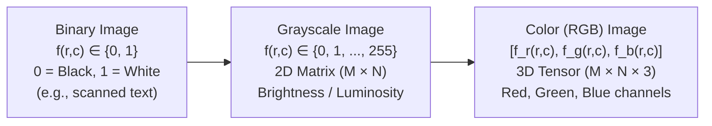

# Week 2 (Part 1): Image Fundamentals, Pixel Relationships & Geometric Transformations

**Sources Covered (100% No-Skip)**:
- `02-week02/01-MLDS_UDA_2026-27_ImageNotes.pdf` (Sections 1 & 2.1–2.5, pp. 3–12)
- `02-week02/02-MLDS_UDA_Slides_IntroImages-1.pdf` (Slides 1–19)
- `02-week02/10-UDA2026-27_Live Session 3_Images_annotated.pdf` (Linear Transformations & Images)

---

## 1. Representing Digital Images (Sections 1 & 2.1)

### 1.1 Continuous (Analog) vs. Discrete (Digital) Images
- **Analog (Pre-computer) Image $f(x, y)$**: Both spatial coordinates $(x, y) \in \mathbb{R}^2$ and intensity $f(x, y) \in \mathbb{R}$ are continuous real numbers.
- **Digital (Discrete) Image $I(r, c)$ or $f(x, y)$**: Sampled on a discrete grid of integers where:
  - $r \in \{1, \dots, M\}$ is the **row index** (vertical coordinate, top to bottom).
  - $c \in \{1, \dots, N\}$ is the **column index** (horizontal coordinate, left to right).
  - $I(r, c)$ is the quantized integer intensity value at pixel $(r, c)$.



- **Concrete Example of Binary, Grayscale, and RGB Pixel Values**:
  Suppose we look at a single pixel at row $r = 2$, column $c = 3$:
  - In a **binary image**: $I(2, 3) = 1$ (pure white).
  - In an **8-bit grayscale image**: $I(2, 3) = 180$ (light gray, since $0$ is black and $255$ is white).
  - In an **8-bit RGB color image**: $\mathbf{I}(2, 3) = [255, \, 215, \, 0]$ (bright sunflower yellow: high Red `255` + high Green `215` + zero Blue `0`).

---

### 1.2 Matrix vs. Vector Representation & Array vs. Matrix Multiplication
An $M \times N$ grayscale image is represented by a 2D matrix $\mathbf{F} \in \mathbb{R}^{M \times N}$:
$$\mathbf{F} = \begin{bmatrix} f_{11} & f_{12} & \dots & f_{1N} \\ f_{21} & f_{22} & \dots & f_{2N} \\ \vdots & \vdots & \ddots & \vdots \\ f_{M1} & f_{M2} & \dots & f_{MN} \end{bmatrix} = \begin{bmatrix} \mathbf{f}_1 & \mathbf{f}_2 & \dots & \mathbf{f}_N \end{bmatrix}, \quad \text{where } \mathbf{f}_i = \begin{bmatrix} f_{1i} & f_{2i} & \dots & f_{Mi} \end{bmatrix}^\top$$

> **Caution (Example 2.1, Notes p. 4): Array Product $\neq$ Matrix Product! (With Concrete Numbers)**
> Suppose we have a $2 \times 2$ image patch $\mathbf{F} = \begin{bmatrix} 10 & 20 \\ 30 & 40 \end{bmatrix}$ and a $2 \times 2$ diagonal mask $\mathbf{G} = \begin{bmatrix} 1 & 0 \\ 0 & 1 \end{bmatrix}$:
> - **1. Array (Elementwise / Hadamard) Product** $f(x, y)g(x, y)$: Multiplies corresponding pixels at the same position $(r, c)$ (used in image masking/windowing!):
>   $$f(x, y)g(x, y) = \begin{bmatrix} 10 \times 1 & 20 \times 0 \\ 30 \times 0 & 40 \times 1 \end{bmatrix} = \begin{bmatrix} \mathbf{10} & \mathbf{0} \\ \mathbf{0} & \mathbf{40} \end{bmatrix} \quad (\text{masks out the off-diagonal pixels!})$$
> - **2. Matrix Product** $\mathbf{F}\mathbf{G}$: Performs row-by-column dot products (since $\mathbf{G} = I_2$ is the identity matrix, $\mathbf{F} I_2 = \mathbf{F}$!):
>   $$\mathbf{F}\mathbf{G} = \begin{bmatrix} 10(1)+20(0) & 10(0)+20(1) \\ 30(1)+40(0) & 30(0)+40(1) \end{bmatrix} = \begin{bmatrix} \mathbf{10} & \mathbf{20} \\ \mathbf{30} & \mathbf{40} \end{bmatrix} \neq \begin{bmatrix} 10 & 0 \\ 0 & 40 \end{bmatrix}$$

---

## 2. Image Formats, Headers & File Signatures (Section 2.2)

### 2.1 Raster (Bitmap) vs. Vector Images

| Feature | Raster (Bitmap) Images | Vector Images |
| :--- | :--- | :--- |
| **How it is stored** | Grid of discrete pixels $(r, c)$ | Mathematical formulas, curves, and paths |
| **Effect of Zooming / Scaling Up** | **Loses quality**: individual pixels become visible (**pixelation**), details blur, edges become jagged/rough | **Infinitely scalable**: remains smooth and crisp at any dimension (missing values are predicted by formulas) |
| **File Size** | Larger (increases with pixel count $M \times N$) | Smaller for geometric/graphic designs |
| **Best Use Cases** | Photographs, medical MRI/CT scans, natural scenes | Logos, icons, typography, large/small format print design |
| **Common Formats** | `tiff`, `psd`, `jpg`, `png`, `gif`, `bmp` | `ai`, `eps`, `svg`, `pdf` |

- **Concrete Example of Raster vs. Vector Storage**:
  To draw a circle of radius $R = 100$ centered at $(200, 200)$:
  - A **Vector file (`svg`)** stores a single mathematical instruction: `<circle cx="200" cy="200" r="100" />` (~40 bytes). If you zoom in $1000\times$, the computer simply re-evaluates $(x-200)^2 + (y-200)^2 = 100^2$ at the new screen resolution, so the curve stays razor-sharp!
  - A **Raster file (`bmp`/`png`)** stores a fixed $400 \times 400 = 160,000$ grid of pixel brightness values. If you zoom in $10\times$, each pixel simply becomes a $10 \times 10$ square block ("staircase" pixelation).

### 2.2 Data Headers & Magic Byte Signatures (Example 2.2, Notes p. 6)
- **Example 2.2 (PNG Signature)**: The first 8 bytes of *every* `.png` file always have the decimal values:
  $$\texttt{137  80  78  71  13  10  26  10}$$
  *(In ASCII, `80 = 'P'`, `78 = 'N'`, `71 = 'G'`!)* Even if someone renames `cat.png` to `cat.jpg`, reading the first 8 bytes immediately reveals it is actually a PNG file.

---

## 3. Spatial and Intensity Resolution (Section 2.3)

### 3.1 Spatial Resolution (Example 2.3)
- **Definition**: A measure of the **smallest discernible physical detail** in an image, always stated *per unit physical distance* (e.g., line pairs per mm, or dots per inch / DPI).
- **Worked Example 2.3 (Notes p. 6)**:
  Suppose a test chart has alternating black and white vertical lines, each of width $W = 0.1\text{ mm}$.
  - 1 black line + 1 adjacent white line = **1 line pair** of total width $2W = 2(0.1\text{ mm}) = 0.2\text{ mm}$.
  - How many line pairs fit in $1\text{ mm}$? $\frac{1\text{ mm}}{2W} = \frac{1}{0.2} = \mathbf{5\text{ line pairs per mm}}$.
- **Concrete Comparison of Pixel Count vs. Spatial Resolution**:
  - Image A is $1000 \times 1000$ pixels printed on a **$1\text{ inch} \times 1\text{ inch}$ stamp** $\implies \mathbf{1000\text{ dpi}}$ (ultra-high spatial resolution).
  - Image B is $1000 \times 1000$ pixels printed on a **$100\text{ inch} \times 100\text{ inch}$ poster** $\implies \mathbf{10\text{ dpi}}$ (blurry/blocky up close).

### 3.2 Intensity (Grayscale) Resolution (Example 2.4)
- **Definition**: Number of bits $k$ used to quantize each pixel's intensity, giving $L = 2^k$ possible gray levels:
  - **$k = 1\text{ bit}$**: $2^1 = 2$ levels (`0` = black, `1` = white).
  - **$k = 2\text{ bits}$**: $2^2 = 4$ levels (`00` = black, `01` = dark gray, `10` = light gray, `11` = white). Smooth sky gradients turn into 4 artificial bands (**false contouring**).
  - **$k = 8\text{ bits}$**: $2^8 = 256$ levels ($0, 1, \dots, 255$).
  - **$k = 16\text{ bits}$**: $2^{16} = 65,536$ levels (used in medical MRI/CT scans to distinguish subtle tissue density differences).

---

## 4. Basic Relationships Between Pixels (Section 2.4)

### 4.1 Neighbors of a Pixel $p(x, y)$ (Section 2.4.1) — Concrete Coordinate Example
Suppose pixel $p$ is at row $x = 5$, column $y = 5$, i.e., $p = (5, 5)$:

```
       (4, 4) [ND]     (4, 5) [N4]     (4, 6) [ND]
       (5, 4) [N4]     (5, 5) [ p]     (5, 6) [N4]
       (6, 4) [ND]     (6, 5) [N4]     (6, 6) [ND]
```

- **4-Neighbors $N_4(p)$** (up, down, left, right): $\{(4, 5), \, (6, 5), \, (5, 4), \, (5, 6)\}$.
- **Diagonal Neighbors $N_D(p)$** (4 corners): $\{(4, 4), \, (4, 6), \, (6, 4), \, (6, 6)\}$.
- **8-Neighbors $N_8(p) = N_4(p) \cup N_D(p)$**: All 8 surrounding pixels above.
- **Open vs. Closed Neighborhood**: The **open** 8-neighborhood has $8$ pixels ($p \notin N_8(p)$); the **closed** 8-neighborhood includes $p(5,5)$ itself ($9$ pixels total).

---

### 4.2 Adjacency, Connectivity, Regions, and Boundaries (Section 2.4.2)

Let $V$ be the set of foreground intensity values (e.g., $V = \{1\}$ in a binary image, or $V = \{100, 101, \dots, 255\}$ in a grayscale image). Two pixels $p, q$ **both having values in $V$** are:
1. **4-Adjacent**: $q \in N_4(p)$.
2. **8-Adjacent**: $q \in N_8(p)$.
3. **m-Adjacent (Mixed Adjacent — Definition 2.5)**:
   - **(Condition 1)** $q \in N_4(p)$, **OR**
   - **(Condition 2)** $q \in N_D(p)$ **AND** $N_4(p) \cap N_4(q)$ contains **no pixels with values in $V$**.

#### Concrete Step-by-Step Walkthrough of Examples 2.6 & 2.7 (Notes pp. 8–9)
Look at this $3 \times 3$ binary image patch where $V = \{1\}$:
```
Pixel Values:           Pixel Names:            8-Adjacency Graph:          m-Adjacency Graph:
  0   1   1               0   q   z               0   q---z                   0   q---z
  0   1   0     ===>      0   p   0     ===>          | /           ===>          |
  0   0   1               0   0   w               0   p   0                   0   p   0
                                                        \                           \
                                                  0   0   w                   0   0   w
```
Let's test the pairs $(p, q)$, $(p, z)$, and $(p, w)$ where $p=(2,2), q=(1,2), z=(1,3), w=(3,3)$ all have value $1 \in V$:
1. **Pair $(p, q)$**: $q=(1,2)$ is directly above $p=(2,2)$, so $q \in N_4(p)$.
   - **4-adjacent?** **Yes!**
   - **8-adjacent?** **Yes!**
   - **$m$-adjacent?** **Yes!** (by Condition 1).
2. **Pair $(p, z)$**: $z=(1,3)$ is top-right of $p=(2,2)$, so $z \in N_D(p)$ (diagonal neighbor).
   - **4-adjacent?** **No!**
   - **8-adjacent?** **Yes!**
   - **$m$-adjacent?** Let's check Condition 2: What are the shared 4-neighbors $N_4(p) \cap N_4(z)$? They are $(1,2) = q$ (value $1$) and $(2,3)$ (value $0$). Because $q$ has value **$1 \in V$**, $N_4(p) \cap N_4(z)$ is **not empty** of $V$-pixels! Therefore, **$p$ and $z$ are NOT $m$-adjacent**!
   - *Why is this awesome?* In the graph above, blocking the diagonal $p \leftrightarrow z$ link forces the path from $z$ to $w$ to go cleanly through $z \to q \to p \to w$ (length $3$) instead of having a redundant shortcut $z \to p \to w$!
3. **Pair $(p, w)$**: $w=(3,3)$ is bottom-right of $p=(2,2)$, so $w \in N_D(p)$.
   - Shared 4-neighbors $N_4(p) \cap N_4(w)$ are $(2,3)$ (value $0$) and $(3,2)$ (value $0$). Neither is in $V = \{1\}$!
   - Therefore, **$p$ and $w$ ARE both 8-adjacent and $m$-adjacent**!

---

#### Concrete Example of Connected Components, Regions & Boundary vs. Edge
Consider this $5 \times 5$ binary image with foreground $V = \{1\}$:
```
    Col 1  Col 2  Col 3  Col 4  Col 5
Row 1:  0      0      0      0      0
Row 2:  0      1      1      1      0
Row 3:  0      1      1*     1      0
Row 4:  0      1      1      1      0
Row 5:  0      0      0      0      1#
```
Let $S$ be the set of all ten `1`-valued pixels in this image:
1. **Connected Components of $S$**:
   - Under **4-connectivity**: The $3 \times 3$ block of nine `1`s in Rows 2–4 is one connected component $R_1$, and the corner pixel `1#` at $(5, 5)$ is a **second, separate connected component $R_2$** (because $(5,5)$ only touches $(4,4)$ diagonally!). So $S$ has **2 connected components**.
   - Under **8-connectivity**: Because $(5,5)$ is 8-adjacent to $(4,4)$, all ten `1`s form **1 single connected component** (a single region $R$).
2. **Boundary (Border/Contour) of the $3 \times 3$ Region $R_1$**:
   - The **boundary** of $R_1$ is the set of pixels in $R_1$ that have at least one background (`0`) neighbor.
   - All 8 outer pixels of the $3 \times 3$ square touch a `0`. Only the center pixel `1*` at $(3, 3)$ is completely surrounded by `1`s!
   - Thus, `1*` at $(3, 3)$ is an **interior pixel**, and the 8 surrounding `1`s form the **closed boundary** of $R_1$.

---

### 4.3 Distance Measures: $d_e$, $d_4$, $d_8$, and $d_m$ (Section 2.4.3)

#### Concrete Numerical Comparison of $d_e$, $d_4$, and $d_8$
Suppose pixel $p$ is at $(x, y) = (1, 1)$ and pixel $q$ is at $(u, v) = (4, 5)$ (so $|\Delta x| = |1 - 4| = 3$ rows and $|\Delta y| = |1 - 5| = 4$ columns):
1. **Euclidean Distance ($d_e$ — straight-line "as the crow flies")**:
   $$d_e(p, q) = \sqrt{(1 - 4)^2 + (1 - 5)^2} = \sqrt{3^2 + 4^2} = \sqrt{9 + 16} = \mathbf{5}$$
2. **City-Block / Manhattan Distance ($d_4$ — only horizontal & vertical 4-neighbor moves allowed)**:
   $$d_4(p, q) = |1 - 4| + |1 - 5| = 3 + 4 = \mathbf{7} \quad (\text{3 steps down} + \text{4 steps right})$$
3. **Chessboard Distance ($d_8$ — king on a chessboard, diagonal moves count as 1 step!)**:
   $$d_8(p, q) = \max(|1 - 4|, \, |1 - 5|) = \max(3, 4) = \mathbf{4} \quad (\text{3 diagonal steps} + \text{1 step right})$$

*(Notice that for any two pixels, we always have $d_8(p, q) \le d_e(p, q) \le d_4(p, q)$: here $4 \le 5 \le 7$!)*

#### Concrete Walkthrough of $d_m$ Distance (Example 2.13, Notes p. 11)
In the arrangement below, $p=(3,1), p_2=(2,2), p_4=(1,3)$ all have value $1$ ($V = \{1\}$):
```
          p₃   p₄(1)
     p₁   p₂(1)
     p(1)
```
Why does $d_m(p, p_4)$ change when we change the values of the off-diagonal pixels $p_1$ and $p_3$?
- **Case 1 ($p_1 = 0, p_3 = 0$)**: No 4-neighbor blocks either diagonal $\implies$ shortest $m$-path is $p \to p_2 \to p_4$ (**length $d_m = 2$**).
- **Case 2 ($p_1 = 1, p_3 = 0$)**: $p_1 = 1$ blocks the first diagonal $p \to p_2$ $\implies$ shortest $m$-path is $p \to p_1 \to p_2 \to p_4$ (**length $d_m = 3$**).
- **Case 3 ($p_1 = 0, p_3 = 1$)**: $p_3 = 1$ blocks the second diagonal $p_2 \to p_4$ $\implies$ shortest $m$-path is $p \to p_2 \to p_3 \to p_4$ (**length $d_m = 3$**).
- **Case 4 ($p_1 = 1, p_3 = 1$)**: Both diagonals are blocked $\implies$ shortest $m$-path is $p \to p_1 \to p_2 \to p_3 \to p_4$ (**length $d_m = 4$**).

---

## 5. Geometric Transformations on Images (Section 2.5 & Intro Slides 13–19)

### 5.1 Affine Transformations in $3 \times 3$ Homogeneous Coordinates (Table 1, Notes p. 12)
$$\begin{bmatrix} x' \\ y' \\ 1 \end{bmatrix} = \mathbf{A} \begin{bmatrix} x \\ y \\ 1 \end{bmatrix} = \begin{bmatrix} a_{11} & a_{12} & a_{13} \\ a_{21} & a_{22} & a_{23} \\ 0 & 0 & 1 \end{bmatrix} \begin{bmatrix} x \\ y \\ 1 \end{bmatrix}$$

| Transformation | Homogeneous Matrix $\mathbf{A}$ | Coordinate Equations | Concrete Example on Point $(x, y) = (2, 4)$ |
| :--- | :---: | :--- | :--- |
| **Identity** | $\begin{bmatrix} 1 & 0 & 0 \\ 0 & 1 & 0 \\ 0 & 0 & 1 \end{bmatrix}$ | $x' = x$<br/>$y' = y$ | $(2, 4) \mapsto \mathbf{(2, 4)}$ |
| **Scaling** | $\begin{bmatrix} c_x & 0 & 0 \\ 0 & c_y & 0 \\ 0 & 0 & 1 \end{bmatrix}$ | $x' = c_x x$<br/>$y' = c_y y$ | With $c_x = 0.5, c_y = 0.5$ (Example 2.14, shrinks image to half size):<br/>$(2, 4) \mapsto \mathbf{(1, 2)}$ |
| **Rotation (about origin)** | $\begin{bmatrix} \cos\theta & -\sin\theta & 0 \\ \sin\theta & \cos\theta & 0 \\ 0 & 0 & 1 \end{bmatrix}$ | $x' = x\cos\theta - y\sin\theta$<br/>$y' = x\sin\theta + y\cos\theta$ | With $\theta = 90^\circ$ ($\cos 90^\circ = 0, \sin 90^\circ = 1$):<br/>$x' = 2(0) - 4(1) = -4$, $y' = 2(1) + 4(0) = 2 \implies \mathbf{(-4, 2)}$ |
| **Translation** | $\begin{bmatrix} 1 & 0 & t_x \\ 0 & 1 & t_y \\ 0 & 0 & 1 \end{bmatrix}$ | $x' = x + t_x$<br/>$y' = y + t_y$ | With $t_x = 10, t_y = -3$:<br/>$(2, 4) \mapsto (2+10, 4-3) = \mathbf{(12, 1)}$ |
| **Shear (vertical)** | $\begin{bmatrix} 1 & s_v & 0 \\ 0 & 1 & 0 \\ 0 & 0 & 1 \end{bmatrix}$ | $x' = x + s_v y$<br/>$y' = y$ | With $s_v = 2$:<br/>$(2, 4) \mapsto (2 + 2(4), 4) = \mathbf{(10, 4)}$ |
| **Shear (horizontal)** | $\begin{bmatrix} 1 & 0 & 0 \\ s_h & 1 & 0 \\ 0 & 0 & 1 \end{bmatrix}$ | $x' = x$<br/>$y' = s_h x + y$ | With $s_h = 3$:<br/>$(2, 4) \mapsto (2, 3(2) + 4) = \mathbf{(2, 10)}$ |

---

### 5.2 Concrete Numerical Example: Chaining Scale $\to$ Rotate $\to$ Translate & Inverse Mapping
Suppose we want to **scale** an image by $(c_x, c_y) = (2, 2)$, **rotate** by $\theta = 90^\circ$, and **translate** by $(t_x, t_y) = (10, 5)$:
1. **Build the Combined Forward Matrix $\mathbf{A} = \mathbf{T} \cdot \mathbf{R} \cdot \mathbf{S}$**:
   $$\mathbf{A} = \underbrace{\begin{bmatrix} 1 & 0 & 10 \\ 0 & 1 & 5 \\ 0 & 0 & 1 \end{bmatrix}}_{\mathbf{T}} \underbrace{\begin{bmatrix} 0 & -1 & 0 \\ 1 & 0 & 0 \\ 0 & 0 & 1 \end{bmatrix}}_{\mathbf{R}} \underbrace{\begin{bmatrix} 2 & 0 & 0 \\ 0 & 2 & 0 \\ 0 & 0 & 1 \end{bmatrix}}_{\mathbf{S}} = \begin{bmatrix} 0 & -2 & 10 \\ 2 & 0 & 5 \\ 0 & 0 & 1 \end{bmatrix}$$
2. **Forward Map a Source Pixel $(x, y) = (2, 4)$**:
   $$\begin{bmatrix} x' \\ y' \\ 1 \end{bmatrix} = \begin{bmatrix} 0 & -2 & 10 \\ 2 & 0 & 5 \\ 0 & 0 & 1 \end{bmatrix}\begin{bmatrix} 2 \\ 4 \\ 1 \end{bmatrix} = \begin{bmatrix} 0(2) - 2(4) + 10 \\ 2(2) + 0(4) + 5 \\ 1 \end{bmatrix} = \begin{bmatrix} \mathbf{2} \\ \mathbf{9} \\ 1 \end{bmatrix}$$
3. **Why We Use Inverse Mapping ($\mathbf{A}^{-1}$) When Coding Image Warping**:
   - Imagine stretching a $2 \times 2$ image by $c_x = 2, c_y = 2$ into a $4 \times 4$ grid. If you only push the $4$ original pixels forward, you only fill $4$ out of the $16$ output pixels, leaving **$12$ black holes**!
   - Instead, for each output pixel $(x', y')$ (such as $(2, 9)$ above), we multiply by $\mathbf{A}^{-1}$ to look up which source pixel $(x, y)$ it came from:
     $$\mathbf{A}^{-1} = \begin{bmatrix} 0 & 0.5 & -2.5 \\ -0.5 & 0 & 5 \\ 0 & 0 & 1 \end{bmatrix} \implies \mathbf{A}^{-1}\begin{bmatrix} 2 \\ 9 \\ 1 \end{bmatrix} = \begin{bmatrix} 0(2) + 0.5(9) - 2.5 \\ -0.5(2) + 0(9) + 5 \\ 1 \end{bmatrix} = \begin{bmatrix} \mathbf{2} \\ \mathbf{4} \\ 1 \end{bmatrix} \text{ (Recovers } (2, 4)\text{!)}$$
