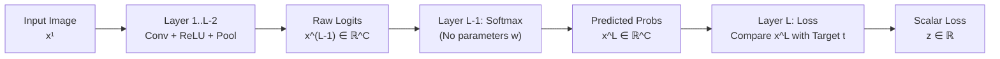
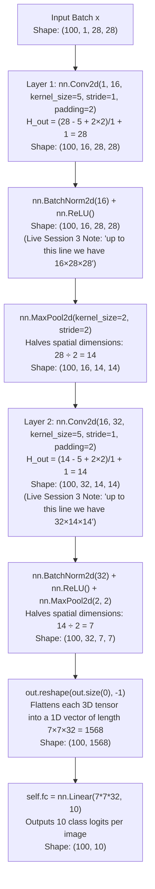

# Week 2 (Part 2): Deep Learning & Convolutional Neural Networks (CNNs)

**Sources Covered (100% No-Skip)**:
- `02-week02/01-MLDS_UDA_2026-27_ImageNotes.pdf` (Sections 3.1–3.3, pp. 13–22)
- `02-week02/03-MLDS_UDA_Slides_CNNImages.pdf` (Slides 1–18)
- `02-week02/04-MLDS_UDA_CNN.ipynb` (Full PyTorch MNIST CNN Notebook)
- `02-week02/09-UDA2026-27_Live Session 2_Images-ANNOTATED.pdf` (Slides 1–11)
- `02-week02/10-UDA2026-27_Live Session 3_Images_annotated.pdf` (Slides 1–3)

---

## 1. Why CNNs? (Live Session 2 Motivation)
1. **Fully connected layers ignore 2D spatial structure** and require too many weights (e.g., connecting a $28 \times 28 = 784$ pixel image to $1000$ hidden neurons requires $784,000$ weights in a single layer!).
2. **CNNs use Local Receptive Fields + Weight Sharing**: A single $5 \times 5$ kernel has only **$25$ weights**, and sliding that same kernel across the entire image detects a feature (like a vertical edge) wherever it appears!

---

## 2. Tensors, Vectorization & Vector Calculus (Section 3.1)

### 2.1 Tensor Orders & Concrete 3D Tensor Indexing Example
A **tensor** is a multidimensional array generalized to any number of dimensions (**order**):
- **Order 0 (Scalar)**: $z = 0.005 \in \mathbb{R}$.
- **Order 1 (Vector)**: $\mathbf{x} = [1, 3, 2, 4]^\top \in \mathbb{R}^4$.
- **Order 2 (Matrix)**: $A = \begin{bmatrix} 1 & 2 \\ 3 & 4 \end{bmatrix} \in \mathbb{R}^{2 \times 2}$.
- **Order 3 (3D Tensor)**: $\mathbf{x} \in \mathbb{R}^{H \times W \times D}$ (contains $D$ channels, each an $H \times W$ matrix, indexed by $(i, j, d)$ with $0 \le i < H, \, 0 \le j < W, \, 0 \le d < D$).
- **Order 4 (4D Tensor)**: A bank of $K$ 3D convolution filters of shape $H \times W \times D \times K$.

#### Concrete Example: Indexing & Recursively Vectorizing an Order-3 Tensor (Example 3.1, p. 14)
Suppose $\mathbf{x} \in \mathbb{R}^{2 \times 2 \times 2}$ is a tiny $2 \times 2$ image with $D = 2$ channels:
$$\text{Channel } d = 0: \quad X_{:,:,0} = \begin{bmatrix} 1 & 2 \\ 3 & 4 \end{bmatrix}, \qquad \text{Channel } d = 1: \quad X_{:,:,1} = \begin{bmatrix} 5 & 6 \\ 7 & 8 \end{bmatrix}$$
- **Index Triplet Lookup**:
  - $\mathbf{x}(0, 0, 0) = 1$ (row 0, col 0, channel 0)
  - $\mathbf{x}(1, 0, 0) = 3$ (row 1, col 0, channel 0)
  - $\mathbf{x}(0, 1, 1) = 6$ (row 0, col 1, channel 1)
- **Recursive Vectorization $\operatorname{vec}(\mathbf{x})$**:
  1. First vectorize Channel 0 column-by-column (Example 3.1): $\operatorname{vec}(X_{:,:,0}) = (1, 3, 2, 4)^\top$.
  2. Next vectorize Channel 1 column-by-column: $\operatorname{vec}(X_{:,:,1}) = (5, 7, 6, 8)^\top$.
  3. Concatenate them in channel order:
     $$\operatorname{vec}(\mathbf{x}) = (1, 3, 2, 4, 5, 7, 6, 8)^\top \in \mathbb{R}^8$$

---

## 3. CNN Architecture, Forward Run, Softmax, Loss & SGD (Section 3.2)

### 3.1 Forward Pass, Softmax & Loss Functions — Concrete 3-Class Example

#### Concrete Numerical Walkthrough of Softmax, Prediction, $\ell_2$ Loss & Cross-Entropy Loss
Suppose our CNN classifies an image into $C = 3$ classes (`0 = Cat`, `1 = Dog`, `2 = Bird`), and the ground-truth label is **Cat** (so the one-hot target vector is $\mathbf{t} = [1, 0, 0]^\top$).
1. **Raw Logits from Layer $L-2$**: Suppose $\mathbf{x}^{L-1} = \begin{bmatrix} 2.0 \\ 1.0 \\ 0.0 \end{bmatrix}$.
2. **Layer $L-1$ (Softmax Transformation — Converts Logits into Probabilities)**:
   $$x_i^L = \frac{e^{x_i^{L-1}}}{\sum_{k=1}^C e^{x_k^{L-1}}}$$
   - Exponentiate each logit: $e^{2.0} \approx 7.389$, $e^{1.0} \approx 2.718$, $e^{0.0} = 1.000$.
   - Sum of exponentials: $7.389 + 2.718 + 1.000 = 11.107$.
   - Divide by the sum to get the probability mass function $\mathbf{x}^L$:
     $$\mathbf{x}^L = \begin{bmatrix} 7.389 / 11.107 \\ 2.718 / 11.107 \\ 1.000 / 11.107 \end{bmatrix} \approx \begin{bmatrix} \mathbf{0.665} \\ \mathbf{0.245} \\ \mathbf{0.090} \end{bmatrix} \quad (\text{Notice } 0.665 + 0.245 + 0.090 = 1.000\text{!})$$
3. **CNN Prediction (Section 3.2.2)**:
   $$\hat{y} = \arg\max_{i \in \{0,1,2\}} x_i^L = \arg\max(0.665, \, 0.245, \, 0.090) = \mathbf{0 \text{ (Cat)}}$$
4. **Layer $L$ (Loss Calculation — Comparing $\mathbf{x}^L$ to Ground Truth $\mathbf{t} = [1, 0, 0]^\top$)**:
   - **Squared $\ell_2$ Loss (Example 3.2, p. 15)**:
     $$z_{\ell_2} = \frac{1}{2}\|\mathbf{t} - \mathbf{x}^L\|^2 = \frac{1}{2}\Big((1 - 0.665)^2 + (0 - 0.245)^2 + (0 - 0.090)^2\Big) = \frac{1}{2}(0.112 + 0.060 + 0.008) = \mathbf{0.090}$$
   - **Cross-Entropy Loss (Standard for Classification)**:
     $$z_{\text{CE}} = -\sum_{i=1}^C t_i \ln(x_i^L) = -\Big(1 \cdot \ln(0.665) + 0 \cdot \ln(0.245) + 0 \cdot \ln(0.090)\Big) = -\ln(0.665) \approx \mathbf{0.408}$$

---

### 3.2 Stochastic Gradient Descent (SGD) & Error Backpropagation (Sections 3.2.3 & 3.2.4)

#### Complete Numerical Walkthrough of Forward Pass, Backprop & SGD Weight Update (Live Session 2 Slides 5–8)
Let's trace the exact numbers from Live Session 2, and then perform one **SGD weight update step** $\mathbf{w} \leftarrow \mathbf{w} - \eta \frac{\partial L}{\partial \mathbf{w}}$ with learning rate $\eta = 0.1$ to prove that the loss decreases!

- **Initial Setup**: Inputs $x_1 = 1, x_2 = 2$; Initial weights $w_1 = 0.5, w_2 = 0.2$; Target $z_{\text{true}} = 1$.
- **Step 1: Forward Pass**:
  1. $y = w_1 x_1 + w_2 x_2 = 0.5(1) + 0.2(2) = \mathbf{0.9}$
  2. $a = \operatorname{ReLU}(y) = \max(0, 0.9) = \mathbf{0.9}$
  3. $\hat{z} = a = \mathbf{0.9}$
  4. $\text{Initial Loss } L_{\text{old}} = \frac{1}{2}(\hat{z} - z_{\text{true}})^2 = 0.5(0.9 - 1)^2 = \mathbf{0.005}$
- **Step 2: Backward Pass (Chain Rule)**:
  - $\frac{\partial L}{\partial \hat{z}} = \hat{z} - z_{\text{true}} = -0.1$, $\quad \frac{\partial \hat{z}}{\partial a} = 1$, $\quad \frac{\partial a}{\partial y} = \operatorname{ReLU}'(0.9) = 1 \implies \frac{\partial L}{\partial y} = (-0.1)(1)(1) = \mathbf{-0.1}$.
  - **Weight Gradients**:
    $$\frac{\partial L}{\partial w_1} = \frac{\partial L}{\partial y}\frac{\partial y}{\partial w_1} = (-0.1)(x_1) = (-0.1)(1) = \mathbf{-0.1}$$
    $$\frac{\partial L}{\partial w_2} = \frac{\partial L}{\partial y}\frac{\partial y}{\partial w_2} = (-0.1)(x_2) = (-0.1)(2) = \mathbf{-0.2}$$
  - **Input Sensitivity Gradients**:
    $$\frac{\partial L}{\partial x_1} = \frac{\partial L}{\partial y}\frac{\partial y}{\partial x_1} = (-0.1)(w_1) = \mathbf{-0.05}, \qquad \frac{\partial L}{\partial x_2} = \frac{\partial L}{\partial y}\frac{\partial y}{\partial x_2} = (-0.1)(w_2) = \mathbf{-0.02}$$
- **Step 3: Perform SGD Weight Update (Eq. 3, Notes p. 16) with $\eta = 0.1$**:
  $$w_1^{\text{new}} = w_1 - \eta \frac{\partial L}{\partial w_1} = 0.5 - 0.1(-0.1) = \mathbf{0.51}$$
  $$w_2^{\text{new}} = w_2 - \eta \frac{\partial L}{\partial w_2} = 0.2 - 0.1(-0.2) = \mathbf{0.22}$$
- **Step 4: Re-run Forward Pass with Updated Weights to Verify Loss Decreased!**
  - New prediction: $\hat{z}^{\text{new}} = 0.51(1) + 0.22(2) = 0.51 + 0.44 = \mathbf{0.95}$ (moved closer to $z_{\text{true}} = 1.0$!).
  - New loss: $L_{\text{new}} = \frac{1}{2}(0.95 - 1.0)^2 = \mathbf{0.00125} < L_{\text{old}} = 0.005$ (Loss dropped by $75\%$ in a single step!).

---

## 4. The Convolution Operation in CNNs (Section 3.2.5, Slides 14–18 & Live Session 2)

### 4.1 Step-by-Step 2D Convolution Examples

#### Worked Example A (Lecture Notes Example 3.4, p. 18)
Input ($3 \times 4$): $\begin{bmatrix} 1 & 2 & 3 & 1 \\ 4 & 5 & 6 & 1 \\ 7 & 8 & 9 & 1 \end{bmatrix}$, Kernel ($2 \times 2$): $\begin{bmatrix} 1 & 1 \\ 1 & 1 \end{bmatrix}$.
- Top-left $(1,1)$: $1(1) + 1(4) + 1(2) + 1(5) = \mathbf{12}$
- Bottom-left $(2,1)$: $1(4) + 1(7) + 1(5) + 1(8) = \mathbf{24}$
- Top-middle $(1,2)$: $1(2) + 1(5) + 1(3) + 1(6) = \mathbf{16}$
- Bottom-middle $(2,2)$: $1(5) + 1(8) + 1(6) + 1(9) = \mathbf{28}$
- Top-right $(1,3)$: $1(3) + 1(6) + 1(1) + 1(1) = \mathbf{11}$
- Bottom-right $(2,3)$: $1(6) + 1(9) + 1(1) + 1(1) = \mathbf{17}$
Output ($2 \times 3$): $\begin{bmatrix} 12 & 16 & 11 \\ 24 & 28 & 17 \end{bmatrix}$.

#### Worked Example B (CNN Slides 14–18)
Same $3 \times 4$ input $\begin{bmatrix} 1 & 2 & 3 & 1 \\ 4 & 5 & 6 & 1 \\ 7 & 8 & 9 & 1 \end{bmatrix}$, with $2 \times 2$ kernel $\begin{bmatrix} 1 & 2 \\ -1 & -1 \end{bmatrix}$:
- $(1,1)$: $1(1) + 2(2) + (-1)(4) + (-1)(5) = \mathbf{-4}$
- $(2,1)$: $1(4) + 2(5) + (-1)(7) + (-1)(8) = \mathbf{-1}$
- $(1,2)$: $1(2) + 2(3) + (-1)(5) + (-1)(6) = \mathbf{-3}$
- $(2,2)$: $1(5) + 2(6) + (-1)(8) + (-1)(9) = \mathbf{0}$
- $(1,3)$: $1(3) + 2(1) + (-1)(6) + (-1)(1) = \mathbf{-2}$
- $(2,3)$: $1(6) + 2(1) + (-1)(9) + (-1)(1) = \mathbf{-2}$
Output ($2 \times 3$): $\begin{bmatrix} -4 & -3 & -2 \\ -1 & 0 & -2 \end{bmatrix}$.

---

### 4.2 Concrete Example of Order-3 Multi-Channel Tensor Convolution (Section 3.2.5, p. 18)
How does convolution work when the input has $D^\ell = 2$ channels (shape $2 \times 2 \times 2$) and the kernel also has $D^\ell = 2$ channels (shape $2 \times 2 \times 2$)?
Suppose at spatial location $(0, 0)$:
- **Input Patch**:
  $$\text{Channel 0: } \begin{bmatrix} 1 & 2 \\ 3 & 4 \end{bmatrix}, \qquad \text{Channel 1: } \begin{bmatrix} 10 & 20 \\ 30 & 40 \end{bmatrix}$$
- **3D Kernel**:
  $$\text{Kernel Channel 0: } \begin{bmatrix} 1 & 0 \\ 0 & 1 \end{bmatrix}, \qquad \text{Kernel Channel 1: } \begin{bmatrix} 0 & 1 \\ 1 & 0 \end{bmatrix}$$
- **Computation**: Multiply corresponding elements in Channel 0, multiply corresponding elements in Channel 1, and **sum all $2 \times 2 \times 2 = 8$ products into a single scalar**:
  $$\text{Output}(0, 0) = \underbrace{\big(1(1) + 2(0) + 3(0) + 4(1)\big)}_{\text{Channel 0 sum } = 5} + \underbrace{\big(10(0) + 20(1) + 30(1) + 40(0)\big)}_{\text{Channel 1 sum } = 50} = 5 + 50 = \mathbf{55}$$

---

### 4.3 Concrete Examples of the Convolution Output Dimension Formula
- **Formula without padding/stride (Section 3.2.5 & Homework 1 Problem 2.2)**:
  $$(M - m + 1) \times (N - n + 1)$$
  - *Example*: A $100 \times 200$ image convolved with a $5 \times 5$ kernel produces a $(100 - 5 + 1) \times (200 - 5 + 1) = \mathbf{96 \times 196}$ matrix.
- **General Formula with Padding $P$ and Stride $S$ (Section 3.3)**:
  $$\left(\left\lfloor\frac{M - m + 2P}{S}\right\rfloor + 1\right) \times \left(\left\lfloor\frac{N - n + 2P}{S}\right\rfloor + 1\right)$$
  - *Example 1 (Same-Size Padding in `UDA_CNN`)*: Input $28 \times 28$, kernel $5 \times 5$, padding $P = 2$, stride $S = 1$:
    $$\frac{28 - 5 + 2(2)}{1} + 1 = 27 + 1 = \mathbf{28 \times 28} \quad (\text{spatial size is preserved!})$$
  - *Example 2 (2×2 MaxPooling in `UDA_CNN`)*: Input $28 \times 28$, pooling window $2 \times 2$, padding $P = 0$, stride $S = 2$:
    $$\frac{28 - 2 + 0}{2} + 1 = 13 + 1 = \mathbf{14 \times 14} \quad (\text{spatial size is halved!})$$

---

## 5. Complete Walkthrough of the PyTorch CNN (`04-MLDS_UDA_CNN.ipynb` & Live Session 3 Slide 3)

### Concrete Numerical Example of `MaxPool2d(kernel_size=2, stride=2)`
How does `MaxPool2d(2, 2)` turn a $4 \times 4$ feature map into a $2 \times 2$ feature map? It divides the $4 \times 4$ matrix into non-overlapping $2 \times 2$ blocks and keeps only the **maximum** number in each block:
$$\begin{bmatrix} \mathbf{1} & \mathbf{5} & 2 & 0 \\ \mathbf{3} & \mathbf{2} & 8 & 4 \\ 0 & 1 & \mathbf{9} & \mathbf{3} \\ 4 & 2 & \mathbf{1} & \mathbf{7} \end{bmatrix}_{4 \times 4} \xrightarrow{\text{MaxPool2d}(2, 2)} \begin{bmatrix} \max(1,5,3,2) & \max(2,0,8,4) \\ \max(0,1,4,2) & \max(9,3,1,7) \end{bmatrix} = \begin{bmatrix} \mathbf{5} & \mathbf{8} \\ \mathbf{4} & \mathbf{9} \end{bmatrix}_{2 \times 2}$$
This provides **translation invariance** (if a detected feature shifts by 1 pixel inside the $2 \times 2$ block, the max-pooled output remains unchanged!) while cutting memory and computation by $75\%$.
